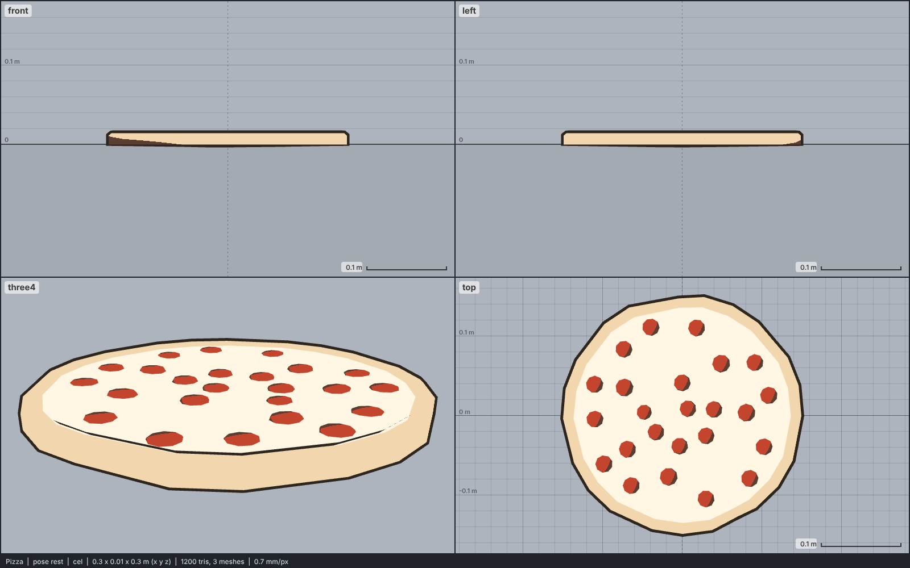

# Model library catalog

> Generated by `npm run library:catalog` from `models/library/*/meta.json`. Do not edit by hand.
> How to use a library model: `harness/library/README.md`. Code models (`models/*.js`) are listed in `skills/html-anime-model/SKILL.md`.

1 model, 0.0 MB of GLB.

## food

| preview | id | model | height | tris | clips | licence | source |
| --- | --- | --- | --- | --- | --- | --- | --- |
|  | `pizza` | Pizza *low-poly, flat colours; a whole pepperoni pizza, a faceted disc with a raised crust rim and about 30 pepperoni slices; normalised by its diameter (0.30 m), which makes it 0.0143 m tall* | 0.0143 m | 1200 | - | CC0 1.0 | [Quaternius · Ultimate Food Pack](https://opengameart.org/content/low-poly-food-pack) |
