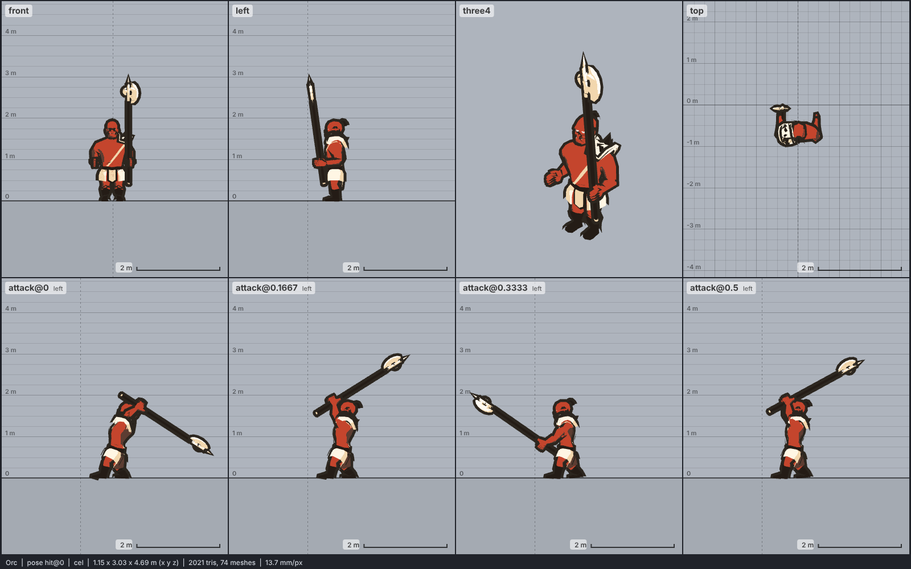

# Model library catalog

> Generated by `npm run library:catalog` from `models/library/*/meta.json`. Do not edit by hand.
> How to use a library model: `harness/library/README.md`. Code models (`models/*.js`) are listed in `skills/html-anime-model/SKILL.md`.

1 model, 0.3 MB of GLB.

## character

| preview | id | model | height | tris | clips | licence | source |
| --- | --- | --- | --- | --- | --- | --- | --- |
|  | `orc` | Orc *low-poly, flat colours, realistic adult proportions (2013 Blender model); 1.95 m to the top of the topknot, a big orc warrior a head taller than a man* | 1.95 m | 1235 | walk, run, attack, hit, death | CC BY 3.0 | [umask007 · Ork (orc barbarian)](https://opengameart.org/content/orc-barbarian) |
