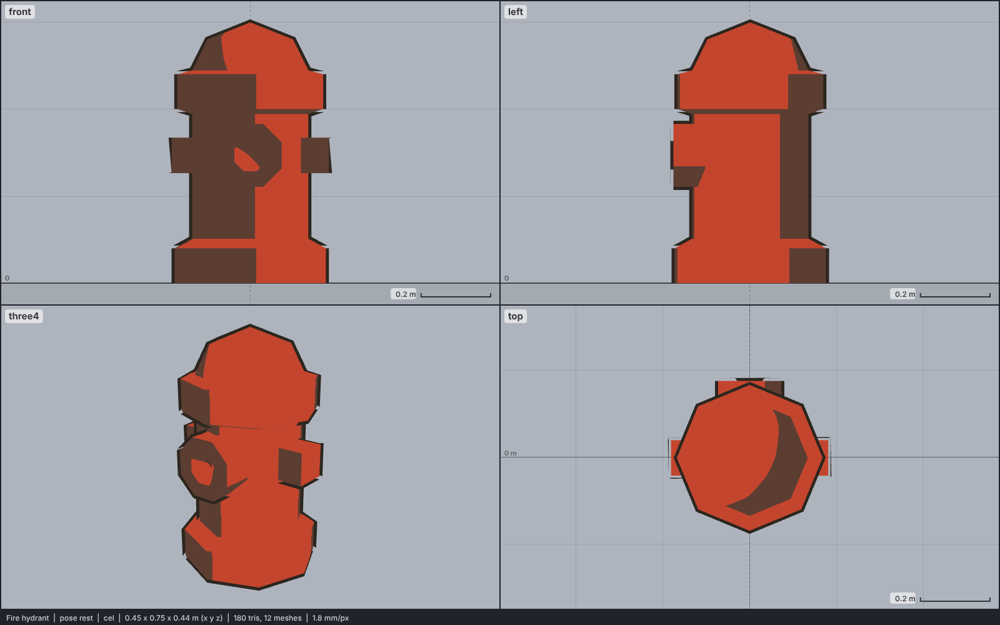

# Model library catalog

> Generated by `npm run library:catalog` from `models/library/*/meta.json`. Do not edit by hand.
> How to use a library model: `harness/library/README.md`. Code models (`models/*.js`) are listed in `skills/html-anime-model/SKILL.md`.

1 model, 0.0 MB of GLB.

## prop-street

| preview | id | model | height | tris | clips | licence | source |
| --- | --- | --- | --- | --- | --- | --- | --- |
|  | `hydrant` | Fire hydrant *low-poly, gradient atlas flattened (KayKit City Builder Bits 2023)* | 0.75 m | 180 | - | CC0 1.0 | [KayKit · City Builder Bits 1.0](https://github.com/KayKit-Game-Assets/KayKit-City-Builder-Bits-1.0) |
