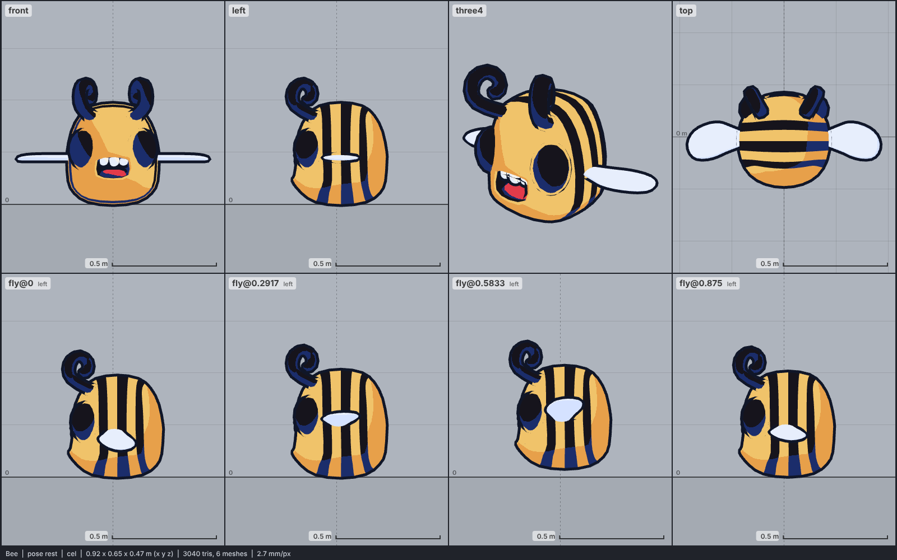

# Model library catalog

> Generated by `npm run library:catalog` from `models/library/*/meta.json`. Do not edit by hand.
> How to use a library model: `harness/library/README.md`. Code models (`models/*.js`) are listed in `skills/html-anime-model/SKILL.md`.

1 model, 0.1 MB of GLB.

## creature

| preview | id | model | height | tris | clips | licence | source |
| --- | --- | --- | --- | --- | --- | --- | --- |
|  | `bee` | Bee *low-poly chibi, flat colours, modelled stripes (Quaternius 2021)* | 0.6 m | 3040 | idle, fly, attack, hit, death | CC0 1.0 | [Quaternius · Ultimate Platformer Pack (Dec 2021)](https://quaternius.itch.io/ultimate-platformer-pack) |
