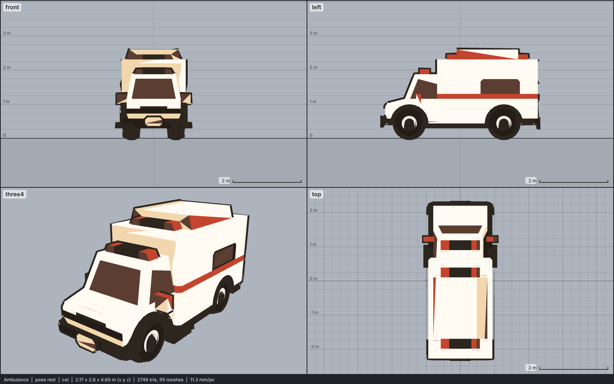

# Model library catalog

> Generated by `npm run library:catalog` from `models/library/*/meta.json`. Do not edit by hand.
> How to use a library model: `harness/library/README.md`. Code models (`models/*.js`) are listed in `skills/html-anime-model/SKILL.md`.

1 model, 0.1 MB of GLB.

## vehicle

| preview | id | model | height | tris | clips | licence | source |
| --- | --- | --- | --- | --- | --- | --- | --- |
|  | `car-ambulance` | Ambulance *low-poly, flat colours (Kenney Car Kit)* | 2.6 m | 2746 | - | CC0 1.0 | [Kenney · Car Kit](https://kenney.nl/assets/car-kit) |
