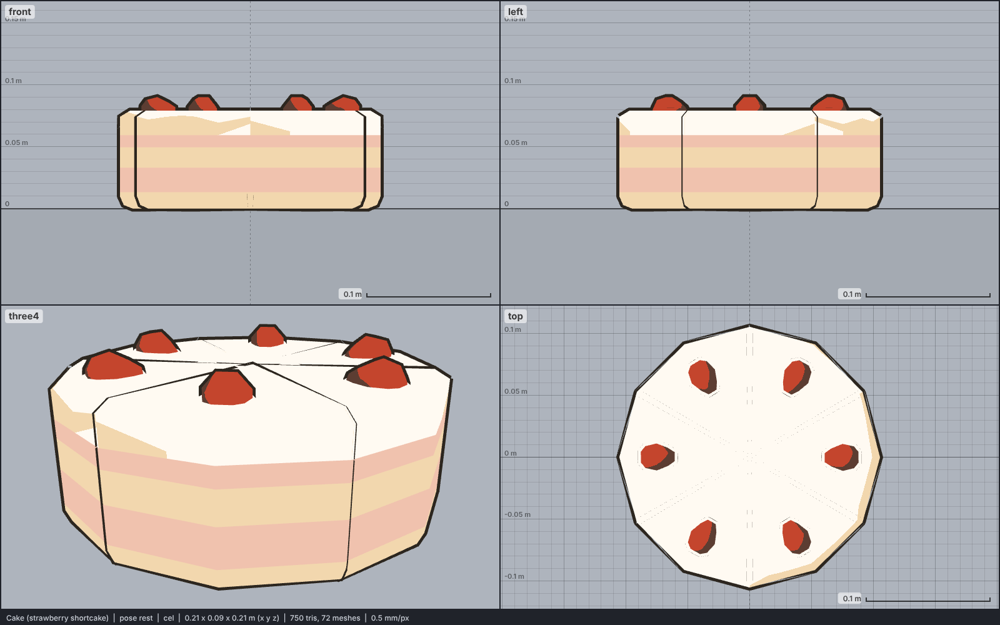

# Model library catalog

> Generated by `npm run library:catalog` from `models/library/*/meta.json`. Do not edit by hand.
> How to use a library model: `harness/library/README.md`. Code models (`models/*.js`) are listed in `skills/html-anime-model/SKILL.md`.

1 model, 0.1 MB of GLB.

## food

| preview | id | model | height | tris | clips | licence | source |
| --- | --- | --- | --- | --- | --- | --- | --- |
|  | `cake` | Cake (strawberry shortcake) *low-poly, colour-map texture flattened to flat colours; a whole round layer cake, pre-cut into six slices, normalised to 0.09 m tall so it is 0.21 m across* | 0.09 m | 750 | - | CC0 1.0 | [Kenney · Food Kit](https://kenney.nl/assets/food-kit) |
