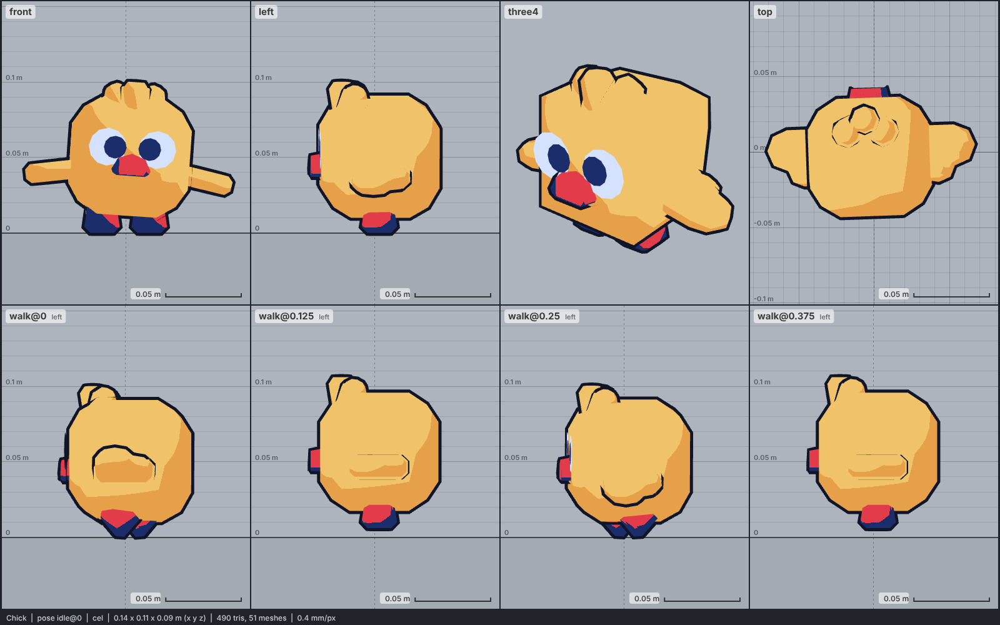

# Model library catalog

> Generated by `npm run library:catalog` from `models/library/*/meta.json`. Do not edit by hand.
> How to use a library model: `harness/library/README.md`. Code models (`models/*.js`) are listed in `skills/html-anime-model/SKILL.md`.

1 model, 0.1 MB of GLB.

## bird

| preview | id | model | height | tris | clips | licence | source |
| --- | --- | --- | --- | --- | --- | --- | --- |
|  | `chick` | Chick *chibi cube pet, deliberately blocky (Kenney Cube Pets); height 0.1 m to the head tuft, a real chick (0.08-0.1 m), so it stands a quarter of the library hen (0.4 m) and at a 1.7 m adult ankle; rigid parts moved by node tracks, no skin; colour map flattened to flat colours* | 0.1 m | 490 | idle, walk, run, eat, dance | CC0 1.0 | [Kenney · Cube Pets](https://kenney.nl/assets/cube-pets) |
