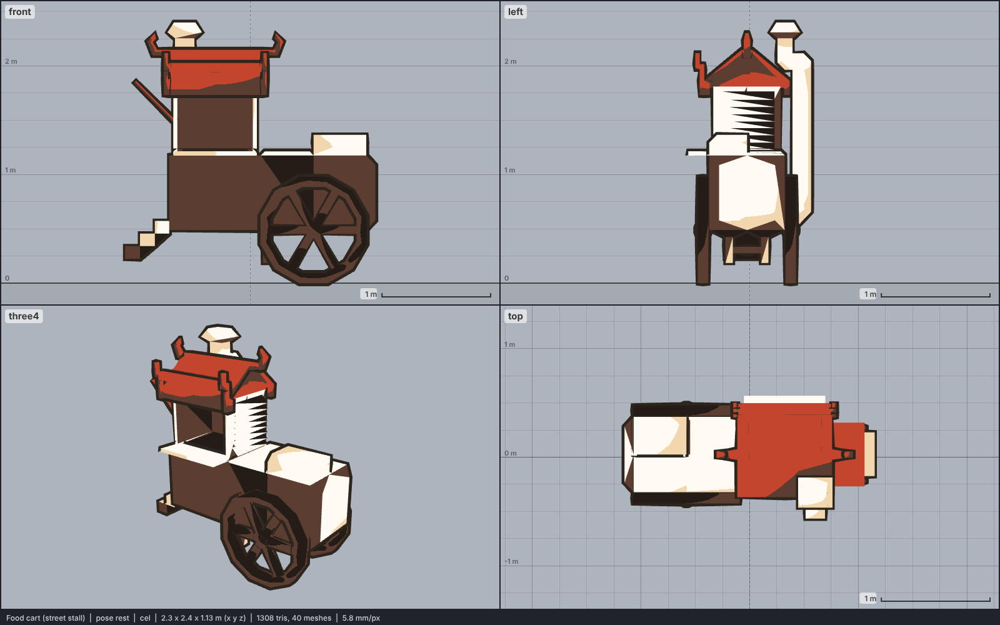

# Model library catalog

> Generated by `npm run library:catalog` from `models/library/*/meta.json`. Do not edit by hand.
> How to use a library model: `harness/library/README.md`. Code models (`models/*.js`) are listed in `skills/html-anime-model/SKILL.md`.

1 model, 0.0 MB of GLB.

## prop-street

| preview | id | model | height | tris | clips | licence | source |
| --- | --- | --- | --- | --- | --- | --- | --- |
|  | `food-cart` | Food cart (street stall) *low-poly, painted textures flattened* | 2.4 m | 1308 | - | CC BY 3.0 | [Ouren · Chinese Food Cart](https://opengameart.org/content/chinese-food-cart) |
