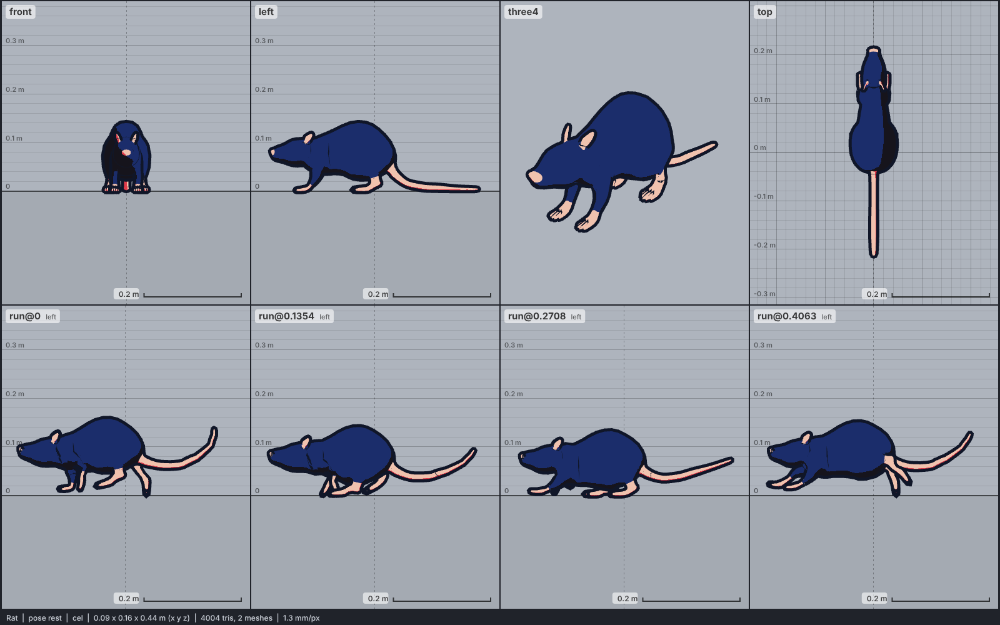

# Model library catalog

> Generated by `npm run library:catalog` from `models/library/*/meta.json`. Do not edit by hand.
> How to use a library model: `harness/library/README.md`. Code models (`models/*.js`) are listed in `skills/html-anime-model/SKILL.md`.

1 model, 0.2 MB of GLB.

## mammal

| preview | id | model | height | tris | clips | licence | source |
| --- | --- | --- | --- | --- | --- | --- | --- |
|  | `rat` | Rat *low-poly, flat colours (Quaternius 2019)* | 0.14 m | 4004 | idle, walk, run, jump, attack, death | CC0 1.0 | [Quaternius · Easy Animated Enemy Pack (Jan 2019)](https://quaternius.itch.io/animated-easy-enemies) |
