# Model library catalog

> Generated by `npm run library:catalog` from `models/library/*/meta.json`. Do not edit by hand.
> How to use a library model: `harness/library/README.md`. Code models (`models/*.js`) are listed in `skills/html-anime-model/SKILL.md`.

97 models, 13.3 MB of GLB.

## bird

| preview | id | model | height | tris | clips | licence | source |
| --- | --- | --- | --- | --- | --- | --- | --- |
| 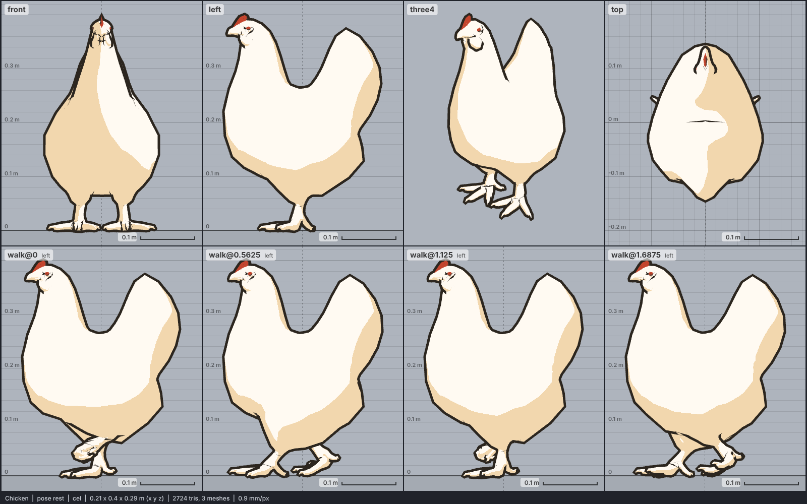 | `chicken` | Chicken *mid-poly, realistic proportions (CDmir 2015); photo texture flattened to flat colours* | 0.4 m | 2724 | idle, walk, eat, death | CC0 1.0 | [CDmir · Chicken (animated, Kelgar)](https://opengameart.org/content/chicken-animated) |
| 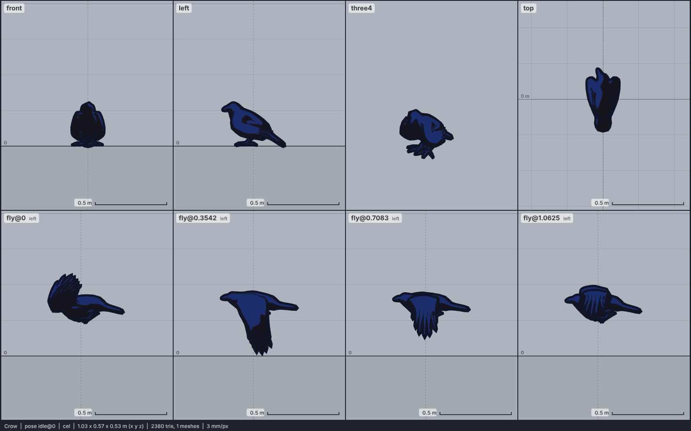 | `crow` | Crow *mid-poly, realistic proportions, cut primary feathers (Teh_Bucket); texture dropped, one flat material* | 0.3 m | 1190 | idle, fly | CC0 1.0 | [Teh_Bucket · Raven](https://opengameart.org/content/raven-0) |
| 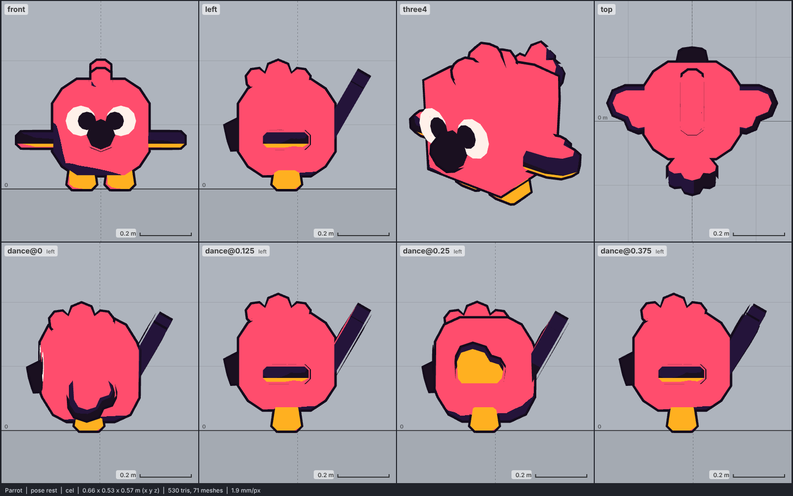 | `parrot` | Parrot *chibi cube pet, deliberately blocky (Kenney Cube Pets); stylized size: 0.5 m to the top of the crest, about a real scarlet macaw standing on a perch (0.4-0.5 m to the crown; 0.8-0.9 m long only with the tail hanging down, which the cube pet's short raised tail does not have), so it is a little over half the cube-pet panda (0.9 m) in the same ratio as the real animals and knee-high to a 1.7 m adult; rigid parts moved by node tracks, no skin; colour map flattened to flat colours* | 0.5 m | 530 | idle, walk, run, dance, eat | CC0 1.0 | [Kenney · Cube Pets](https://kenney.nl/assets/cube-pets) |
| 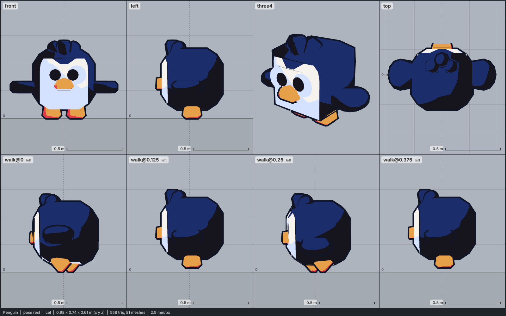 | `penguin` | Penguin *chibi cube pet, deliberately blocky (Kenney Cube Pets); stylized size: 0.7 m to the top of the crest, the standing height of a gentoo or Adelie penguin (an emperor stands ~1.1 m), so it sits between the library's fox (0.48 m) and pig (0.85 m) and comes up to about the cube-pet lion's (1.3 m) shoulder, the same near-real scale the lion uses, while the big cube head keeps it chibi; rigid parts moved by node tracks, no skin; colour map flattened to flat colours* | 0.7 m | 558 | idle, walk, run, dance, eat | CC0 1.0 | [Kenney · Cube Pets](https://kenney.nl/assets/cube-pets) |

## building

| preview | id | model | height | tris | clips | licence | source |
| --- | --- | --- | --- | --- | --- | --- | --- |
| 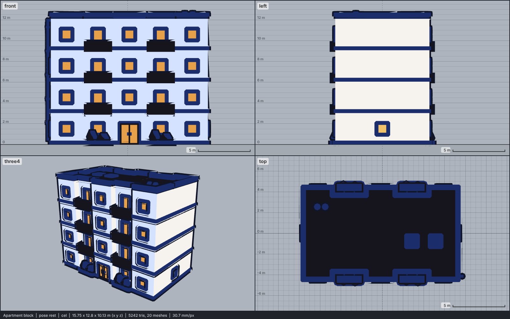 | `building-apartment` | Apartment block *low-poly, flat colours (Kenney City Kit Commercial)* | 12.8 m | 5242 | - | CC0 1.0 | [Kenney · City Kit Commercial](https://kenney.nl/assets/city-kit-commercial) |
| 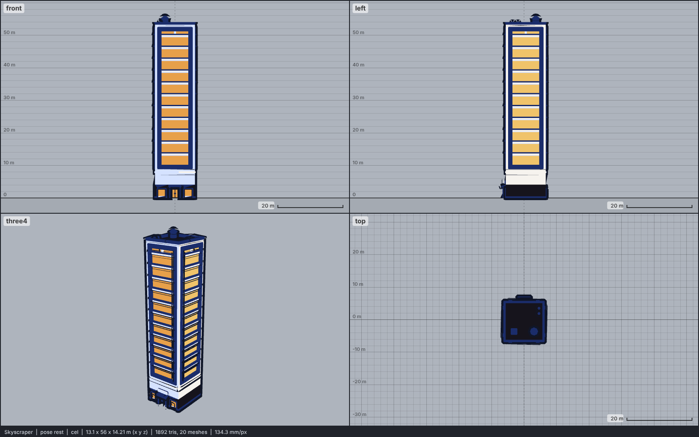 | `building-tower` | Skyscraper *low-poly, flat colours (Kenney City Kit Commercial)* | 56 m | 1892 | - | CC0 1.0 | [Kenney · City Kit Commercial](https://kenney.nl/assets/city-kit-commercial) |
| 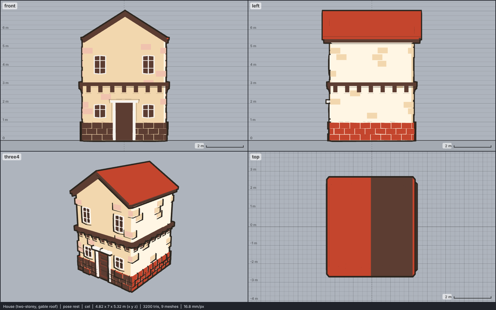 | `house` | House (two-storey, gable roof) *low-poly, flat colours (Quaternius Ultimate Building Pack, 'Models with Materials')* | 7 m | 3200 | - | CC0 1.0 | [Quaternius · Ultimate Textured Building Pack](https://opengameart.org/content/lowpoly-buildings-pack) |
| 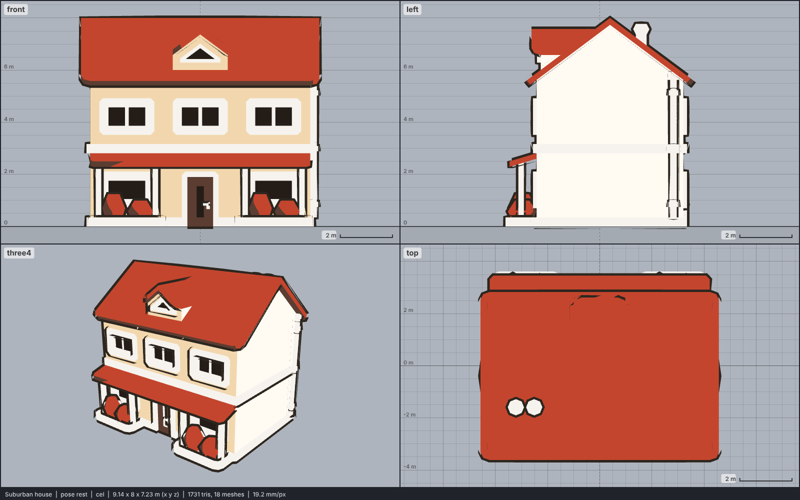 | `house-suburban` | Suburban house *low-poly, flat colours (Kenney City Kit Suburban)* | 8 m | 1731 | - | CC0 1.0 | [Kenney · City Kit Suburban](https://kenney.nl/assets/city-kit-suburban) |
| 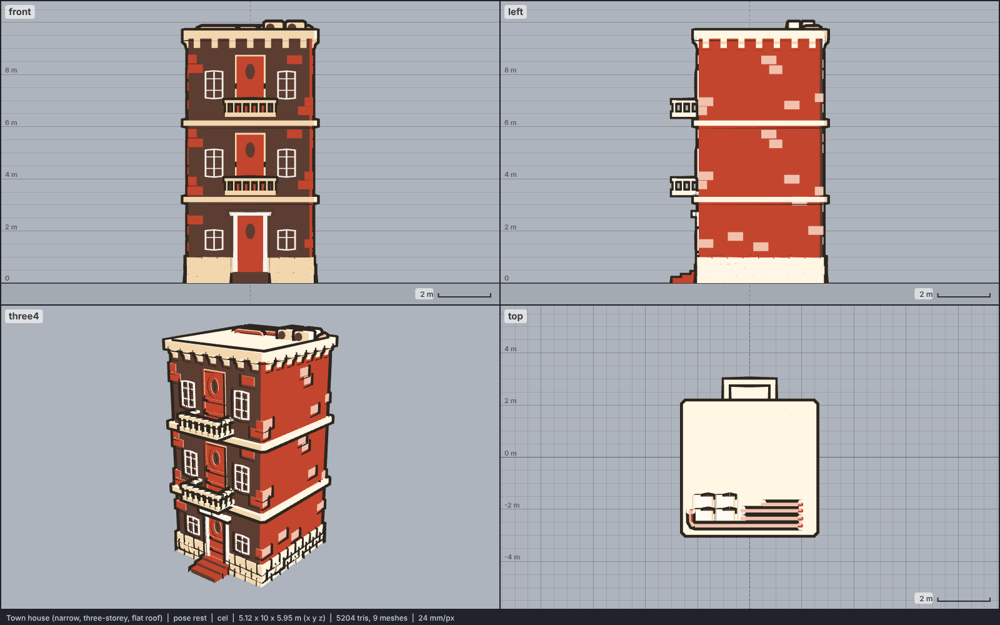 | `house-town` | Town house (narrow, three-storey, flat roof) *low-poly, flat colours (Quaternius Ultimate Building Pack, 'Models with Materials')* | 10 m | 5204 | - | CC0 1.0 | [Quaternius · Ultimate Textured Building Pack](https://opengameart.org/content/lowpoly-buildings-pack) |

## character

| preview | id | model | height | tris | clips | licence | source |
| --- | --- | --- | --- | --- | --- | --- | --- |
| 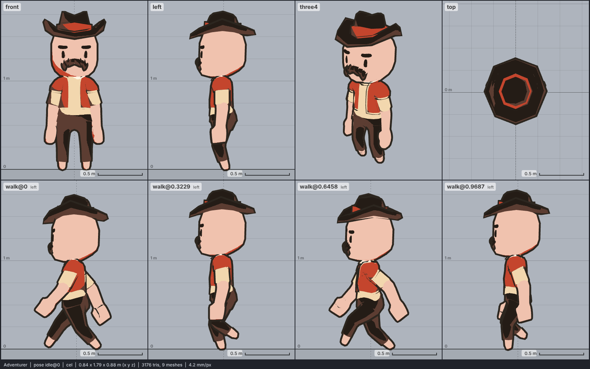 | `adventurer` | Adventurer *low-poly, flat colours, chibi big-head proportions (Quaternius 2019)* | 1.8 m | 3176 | idle, walk, attack, hit, sit | CC0 1.0 | [Quaternius · Ultimate Animated Character Pack (Nov 2019)](https://opengameart.org/content/animated-characters-pack) |
| 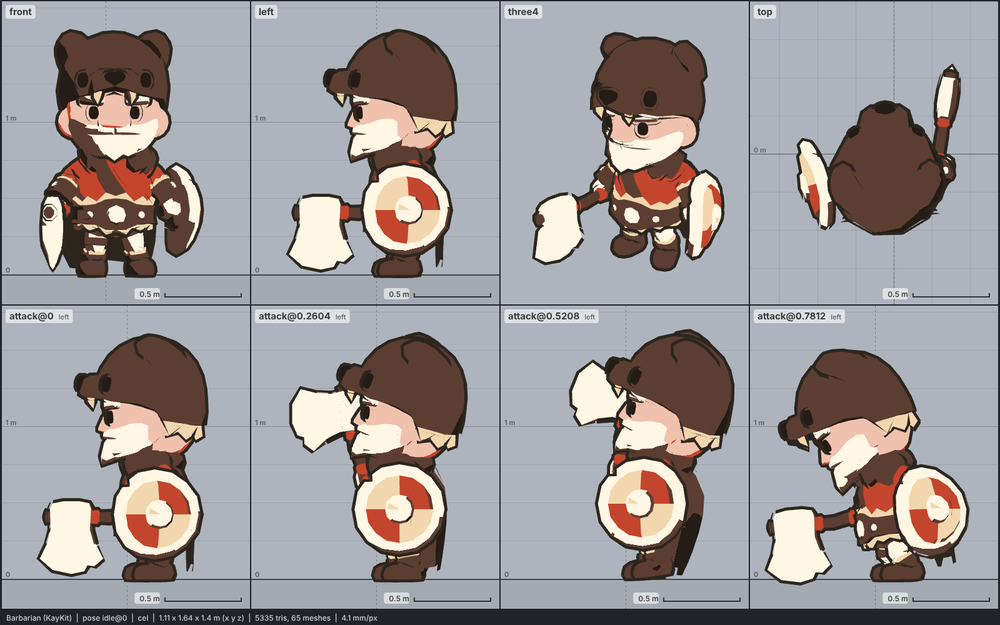 | `barbarian-kaykit` | Barbarian (KayKit) *chibi low-poly, hard-surface, gradient atlas flattened (KayKit 2023)* | 1.6 m | 5335 | idle, walk, run, jump, attack, hit, death, sit, block | CC0 1.0 | [KayKit · Character Pack Adventures 1.0](https://github.com/KayKit-Game-Assets/KayKit-Character-Pack-Adventures-1.0) |
| 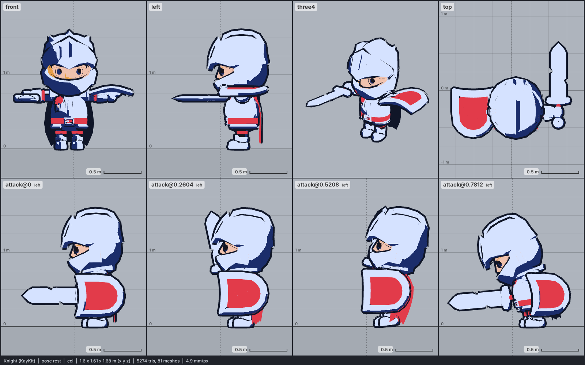 | `knight-kaykit` | Knight (KayKit) *chibi low-poly, hard-surface, gradient atlas flattened (KayKit 2023)* | 1.6 m | 5274 | idle, walk, run, jump, attack, hit, death, sit, block | CC0 1.0 | [KayKit · Character Pack Adventures 1.0](https://github.com/KayKit-Game-Assets/KayKit-Character-Pack-Adventures-1.0) |
| 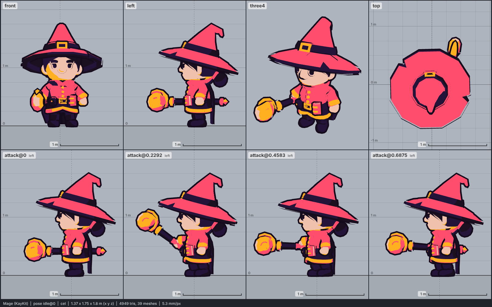 | `mage-kaykit` | Mage (KayKit) *chibi low-poly, gradient atlas flattened (KayKit 2023)* | 1.76 m | 4949 | idle, walk, run, jump, attack, hit, death, sit, block, cast | CC0 1.0 | [KayKit · Character Pack Adventures 1.0](https://github.com/KayKit-Game-Assets/KayKit-Character-Pack-Adventures-1.0) |
| 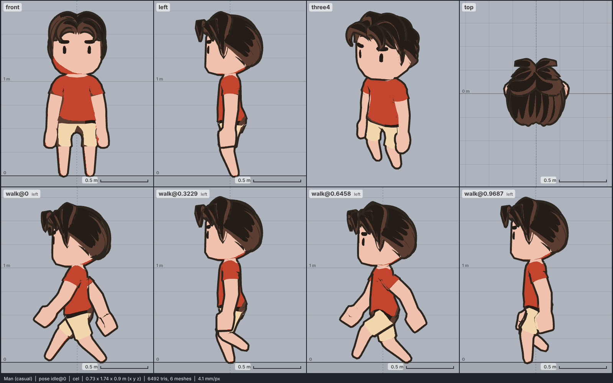 | `man-casual` | Man (casual) *low-poly, flat colours, chibi big-head proportions (Quaternius 2019)* | 1.75 m | 6492 | idle, walk, attack, hit, sit | CC0 1.0 | [Quaternius · Ultimate Animated Character Pack (Nov 2019)](https://opengameart.org/content/animated-characters-pack) |
| 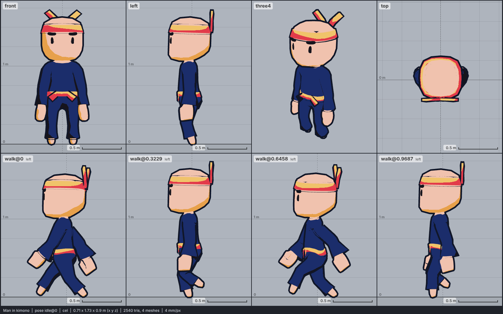 | `man-kimono` | Man in kimono *low-poly, flat colours, chibi big-head proportions (Quaternius 2019)* | 1.75 m | 2540 | idle, walk, attack, hit, sit | CC0 1.0 | [Quaternius · Ultimate Animated Character Pack (Nov 2019)](https://opengameart.org/content/animated-characters-pack) |
| 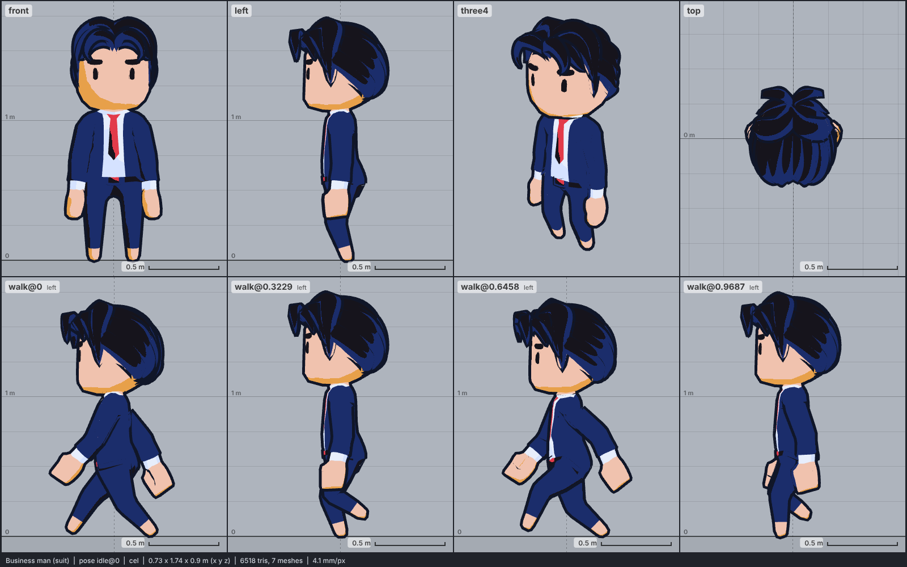 | `man-suit` | Business man (suit) *low-poly, flat colours, chibi big-head proportions (Quaternius 2019)* | 1.75 m | 6518 | idle, walk, attack, hit, sit | CC0 1.0 | [Quaternius · Ultimate Animated Character Pack (Nov 2019)](https://opengameart.org/content/animated-characters-pack) |
| 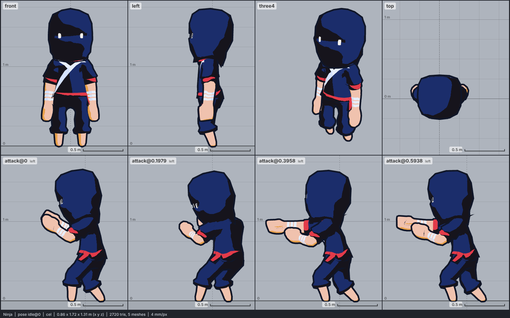 | `ninja` | Ninja *low-poly, flat colours, chibi big-head proportions (Quaternius 2019)* | 1.75 m | 2720 | idle, walk, attack, hit, sit | CC0 1.0 | [Quaternius · Ultimate Animated Character Pack (Nov 2019)](https://opengameart.org/content/animated-characters-pack) |
| 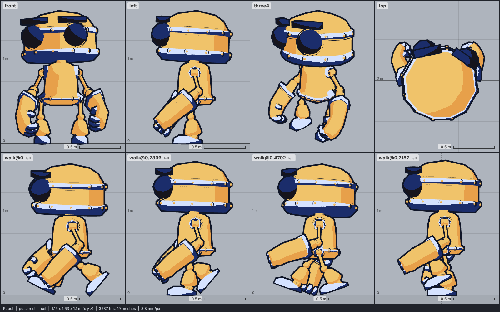 | `robot` | Robot *low-poly, flat colours (Quaternius, three.js examples)* | 1.6 m | 3237 | idle, walk, run, jump, attack, death, wave, dance, yes, no | CC0 1.0 | [three.js examples · RobotExpressive](https://github.com/mrdoob/three.js/tree/r186/examples/models/gltf/RobotExpressive) |
| 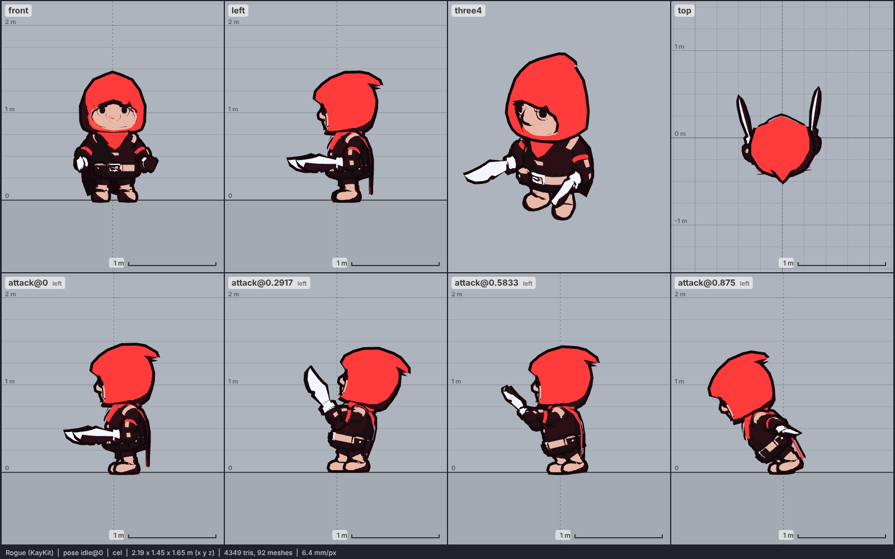 | `rogue-kaykit` | Rogue (KayKit) *chibi low-poly, gradient atlas flattened (KayKit 2023)* | 1.46 m | 4349 | idle, walk, run, jump, attack, hit, death, sit, block | CC0 1.0 | [KayKit · Character Pack Adventures 1.0](https://github.com/KayKit-Game-Assets/KayKit-Character-Pack-Adventures-1.0) |
| 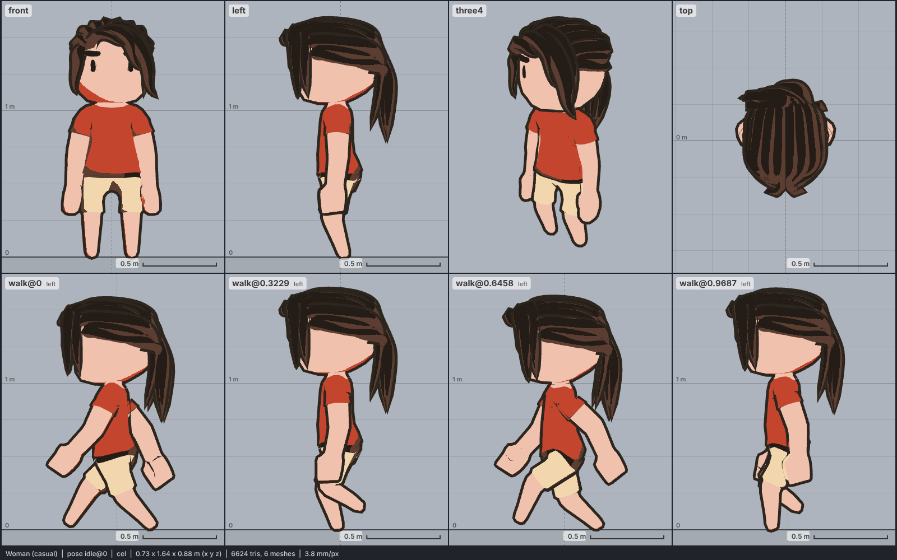 | `woman-casual` | Woman (casual) *low-poly, flat colours, chibi big-head proportions (Quaternius 2019)* | 1.65 m | 6624 | idle, walk, attack, hit, sit | CC0 1.0 | [Quaternius · Ultimate Animated Character Pack (Nov 2019)](https://opengameart.org/content/animated-characters-pack) |
| 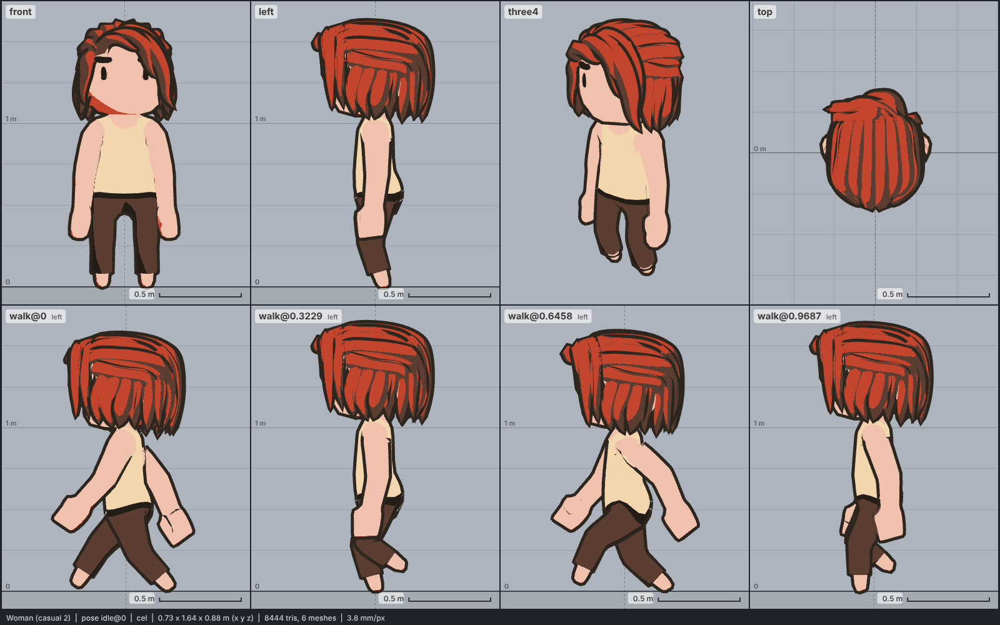 | `woman-casual-2` | Woman (casual 2) *low-poly, flat colours, chibi big-head proportions (Quaternius 2019)* | 1.65 m | 8444 | idle, walk, attack, hit, sit | CC0 1.0 | [Quaternius · Ultimate Animated Character Pack (Nov 2019)](https://opengameart.org/content/animated-characters-pack) |
| 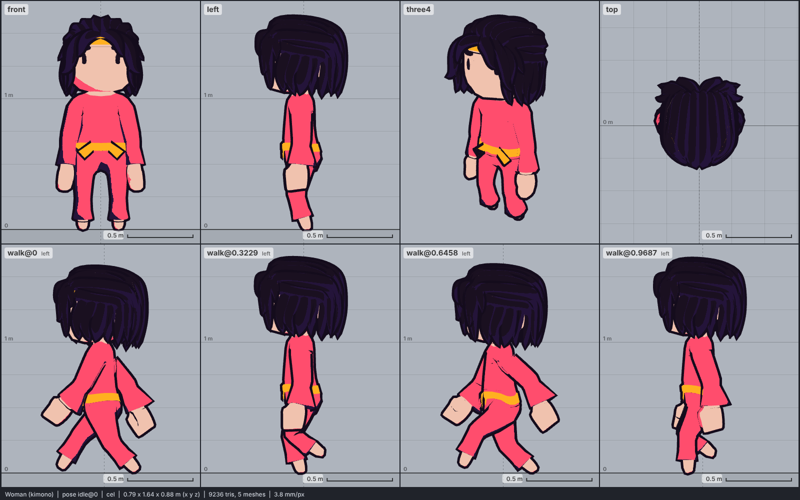 | `woman-kimono` | Woman (kimono) *low-poly, flat colours, chibi big-head proportions (Quaternius 2019)* | 1.65 m | 9236 | idle, walk, attack, hit, sit | CC0 1.0 | [Quaternius · Ultimate Animated Character Pack (Nov 2019)](https://opengameart.org/content/animated-characters-pack) |
| 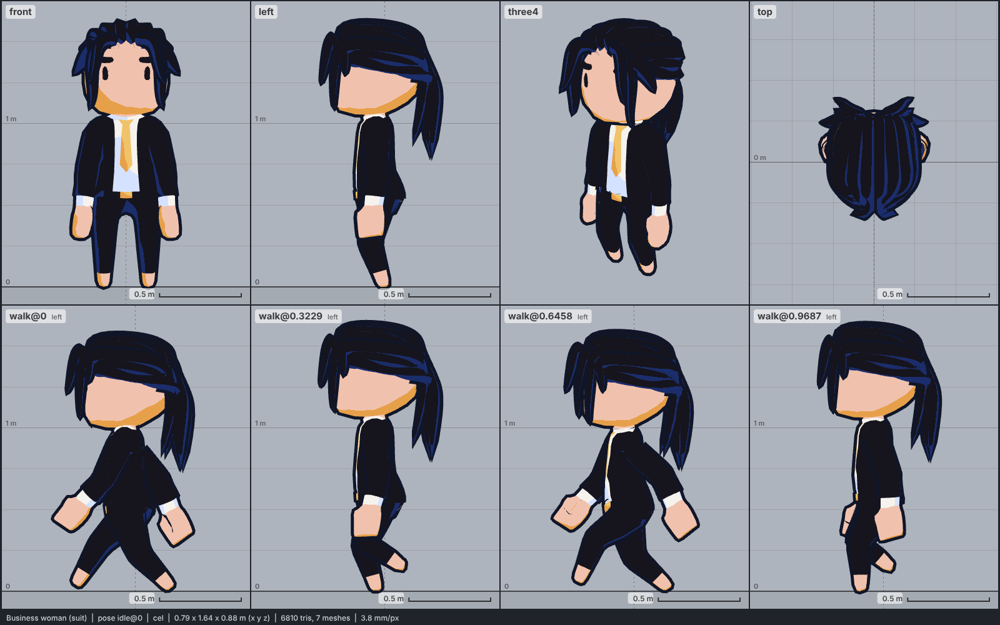 | `woman-suit` | Business woman (suit) *low-poly, flat colours, chibi big-head proportions (Quaternius 2019)* | 1.65 m | 6810 | idle, walk, attack, hit, sit | CC0 1.0 | [Quaternius · Ultimate Animated Character Pack (Nov 2019)](https://opengameart.org/content/animated-characters-pack) |
| 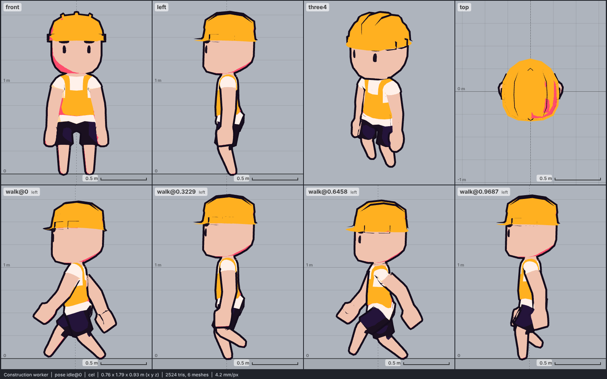 | `worker` | Construction worker *low-poly, flat colours, chibi big-head proportions (Quaternius 2019)* | 1.8 m | 2524 | idle, walk, attack, hit, sit | CC0 1.0 | [Quaternius · Ultimate Animated Character Pack (Nov 2019)](https://opengameart.org/content/animated-characters-pack) |

## creature

| preview | id | model | height | tris | clips | licence | source |
| --- | --- | --- | --- | --- | --- | --- | --- |
| 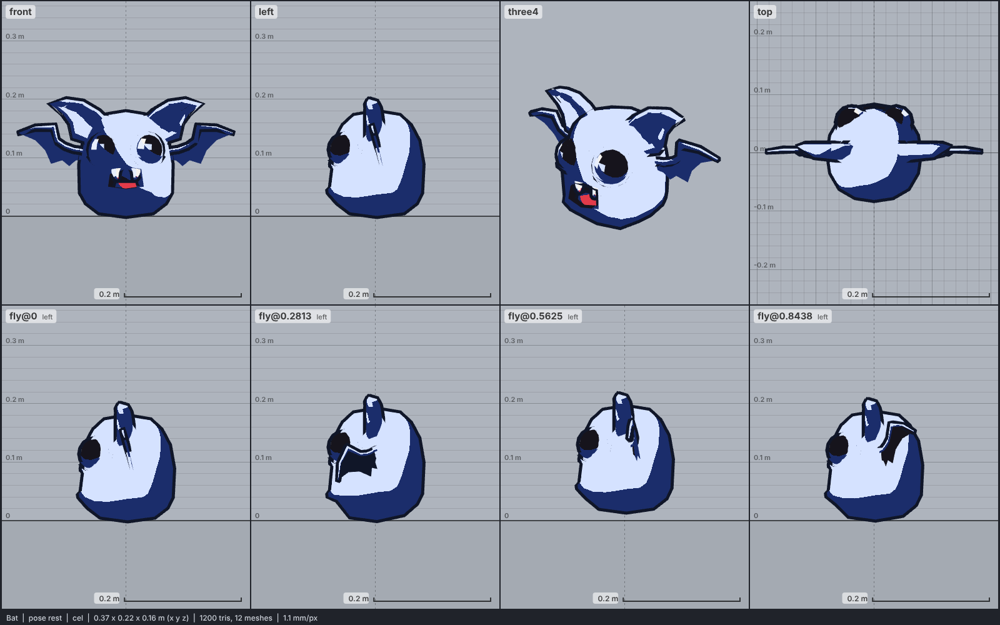 | `bat` | Bat *low-poly, flat colours (Quaternius 2018)* | 0.3 m | 1046 | idle, fly, attack, hit, death | CC0 1.0 | [Quaternius · Animated Monster Pack (2018)](https://opengameart.org/content/lowpoly-animated-monsters) |
| 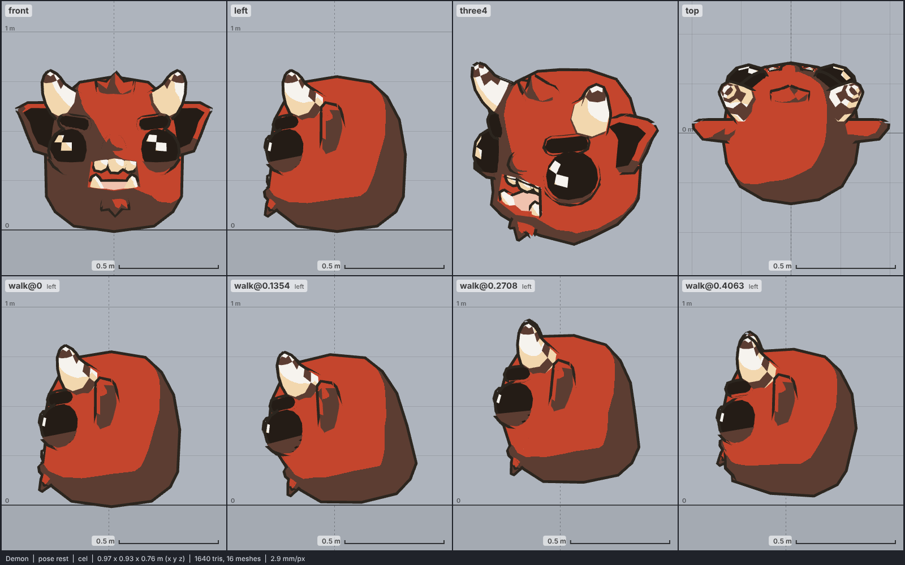 | `demon` | Demon *low-poly chibi, painted texture flattened to flat colours (Quaternius 2020)* | 0.8 m | 1640 | idle, walk, jump, death, hit, attack, dance | CC0 1.0 | [Quaternius · Textured Cute Monster Pack (Aug 2020)](https://opengameart.org/content/textured-cute-monster-pack) |
| 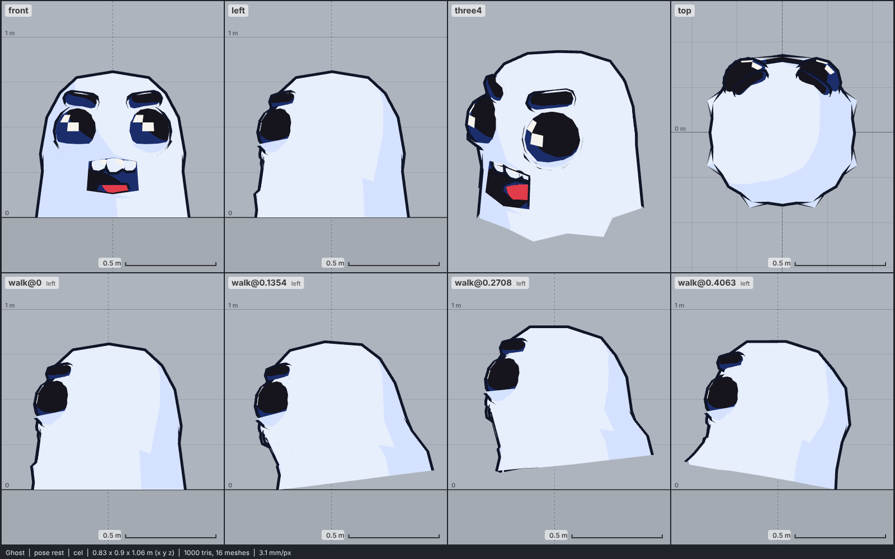 | `ghost` | Ghost *low-poly chibi, painted texture flattened to flat colours (Quaternius 2020)* | 0.8 m | 1000 | idle, walk, jump, death, hit, attack, dance | CC0 1.0 | [Quaternius · Textured Cute Monster Pack (Aug 2020)](https://opengameart.org/content/textured-cute-monster-pack) |
| 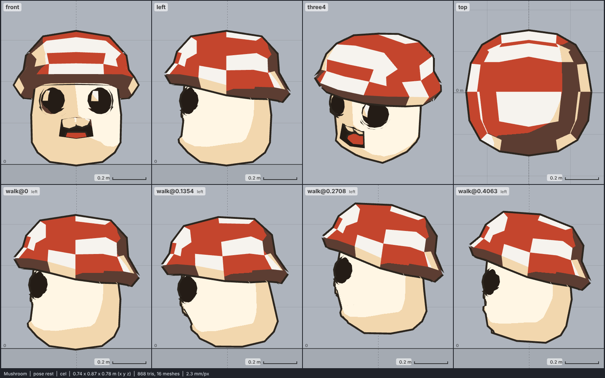 | `mushroom` | Mushroom *low-poly chibi, painted texture flattened to flat colours (Quaternius 2020)* | 0.8 m | 868 | idle, walk, jump, death, hit, attack, dance | CC0 1.0 | [Quaternius · Textured Cute Monster Pack (Aug 2020)](https://opengameart.org/content/textured-cute-monster-pack) |

## creature-monster

| preview | id | model | height | tris | clips | licence | source |
| --- | --- | --- | --- | --- | --- | --- | --- |
| 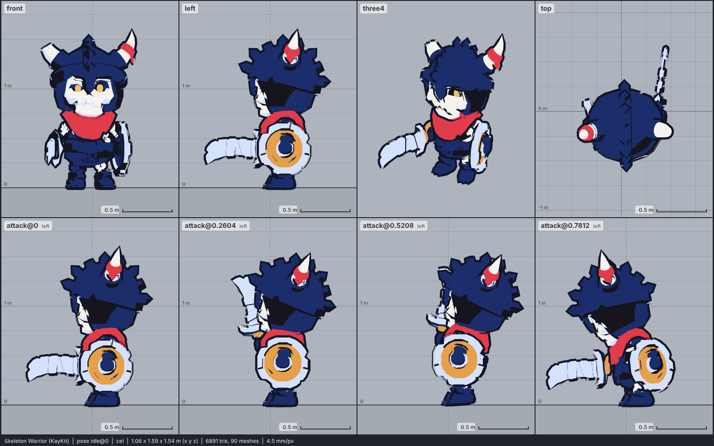 | `skeleton-warrior` | Skeleton Warrior (KayKit) *chibi low-poly, hard-surface, gradient atlas flattened (KayKit 2024)* | 1.6 m | 6891 | idle, walk, run, jump, attack, hit, death, sit, block | CC0 1.0 | [KayKit · Character Pack Skeletons 1.0](https://github.com/KayKit-Game-Assets/KayKit-Character-Pack-Skeletons-1.0) |

## dinosaur

| preview | id | model | height | tris | clips | licence | source |
| --- | --- | --- | --- | --- | --- | --- | --- |
| 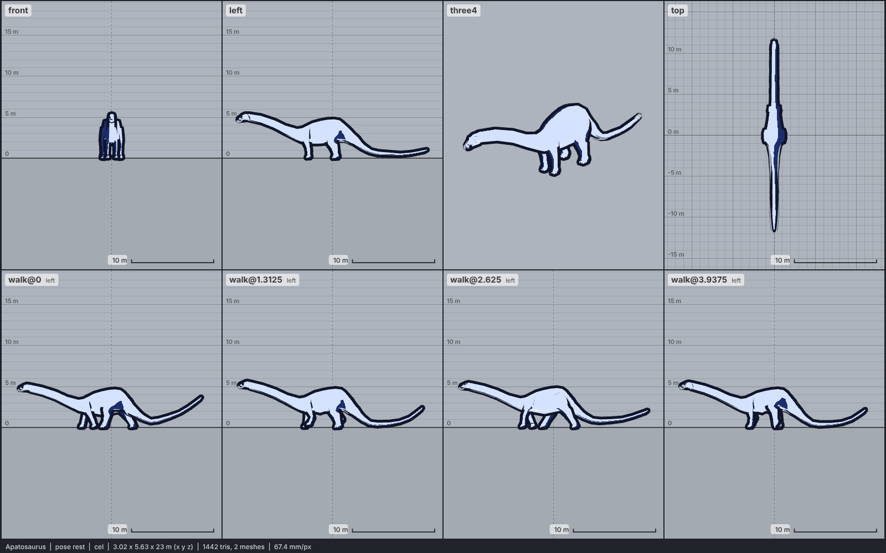 | `apatosaurus` | Apatosaurus *low-poly, flat colours* | 5.4 m | 1442 | idle, walk, run, attack, jump, death | CC0 1.0 | [Quaternius · Animated LowPoly Dinosaurs](https://quaternius.itch.io/animated-lowpoly-dinosaurs) |
| 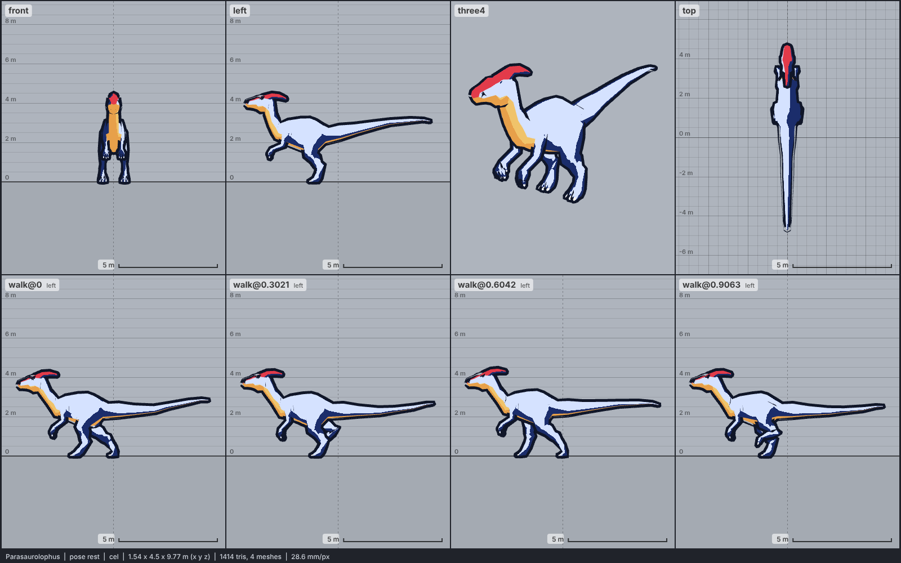 | `parasaurolophus` | Parasaurolophus *low-poly, flat colours* | 4.5 m | 1414 | idle, walk, run, attack, jump, death | CC0 1.0 | [Quaternius · Animated LowPoly Dinosaurs](https://quaternius.itch.io/animated-lowpoly-dinosaurs) |
| 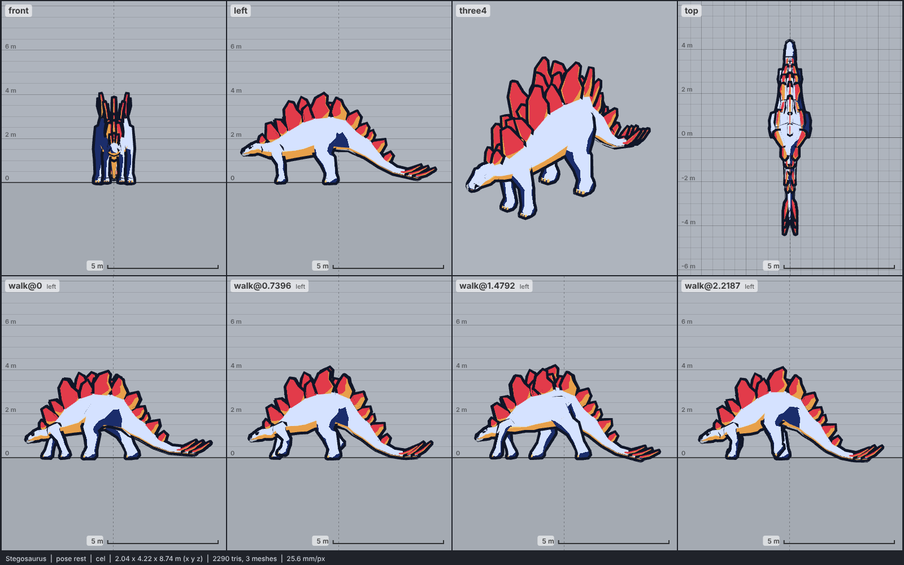 | `stegosaurus` | Stegosaurus *low-poly, flat colours* | 4 m | 2290 | idle, walk, run, attack, jump, death | CC0 1.0 | [Quaternius · Animated LowPoly Dinosaurs](https://quaternius.itch.io/animated-lowpoly-dinosaurs) |
| 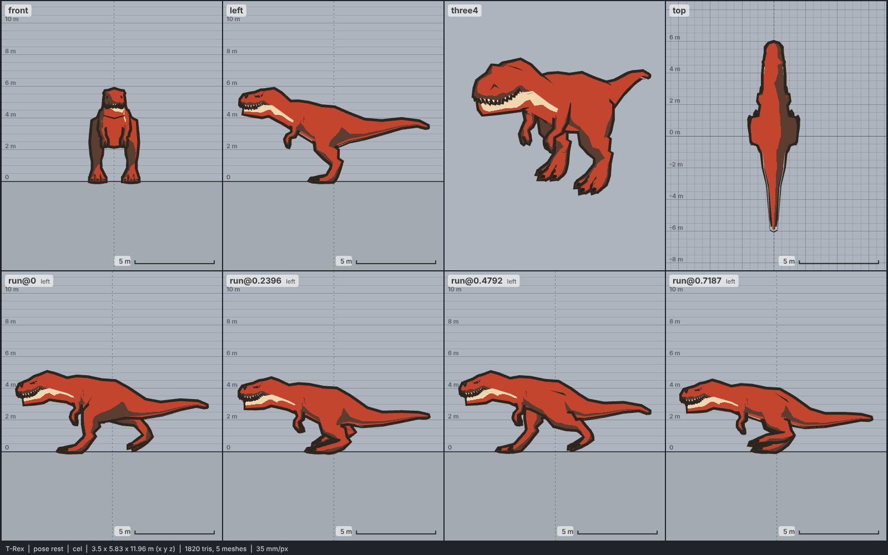 | `t-rex` | T-Rex *low-poly, flat colours* | 5.8 m | 1820 | idle, walk, run, attack, jump, death | CC0 1.0 | [Quaternius · Animated LowPoly Dinosaurs](https://quaternius.itch.io/animated-lowpoly-dinosaurs) |
| 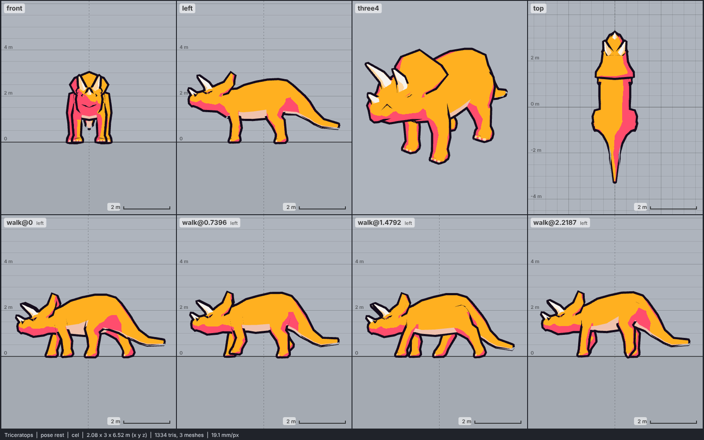 | `triceratops` | Triceratops *low-poly, flat colours* | 3 m | 1334 | idle, walk, run, attack, jump, death | CC0 1.0 | [Quaternius · Animated LowPoly Dinosaurs](https://quaternius.itch.io/animated-lowpoly-dinosaurs) |
| 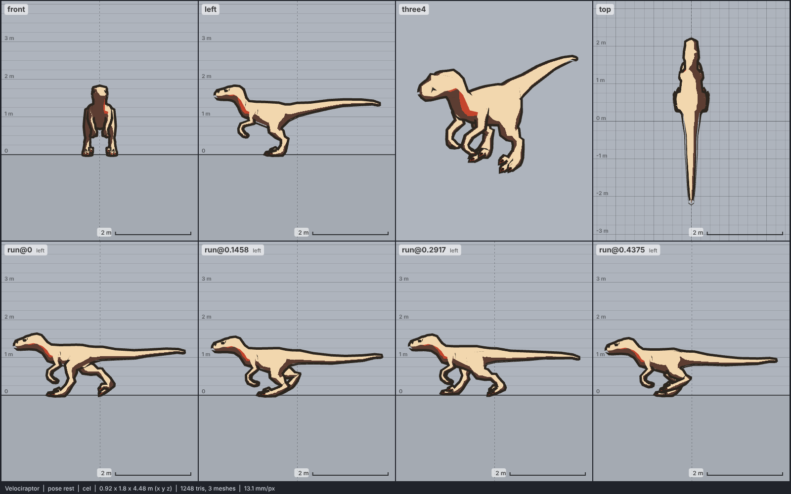 | `velociraptor` | Velociraptor *low-poly, flat colours* | 1.8 m | 1248 | idle, walk, run, attack, jump, death | CC0 1.0 | [Quaternius · Animated LowPoly Dinosaurs](https://quaternius.itch.io/animated-lowpoly-dinosaurs) |

## fish

| preview | id | model | height | tris | clips | licence | source |
| --- | --- | --- | --- | --- | --- | --- | --- |
| 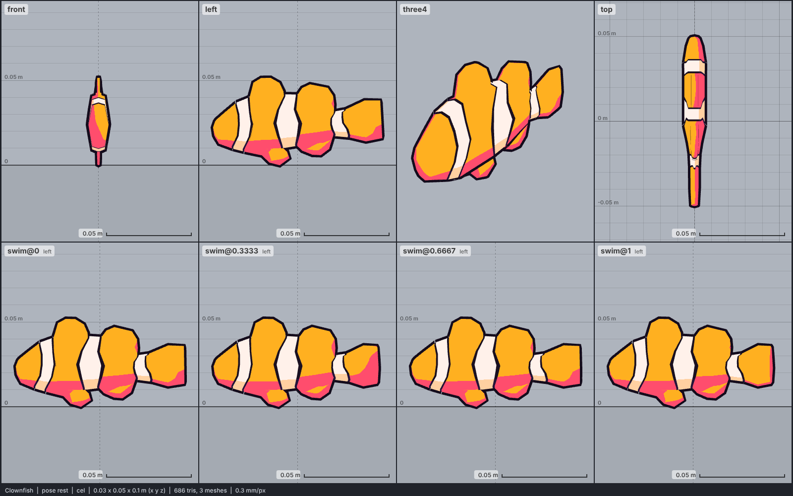 | `clownfish` | Clownfish *low-poly, flat colours (Quaternius 2018)* | 0.0515 m | 686 | swim | CC0 1.0 | [Quaternius · Animated Fish](https://opengameart.org/content/animated-fish) |
| 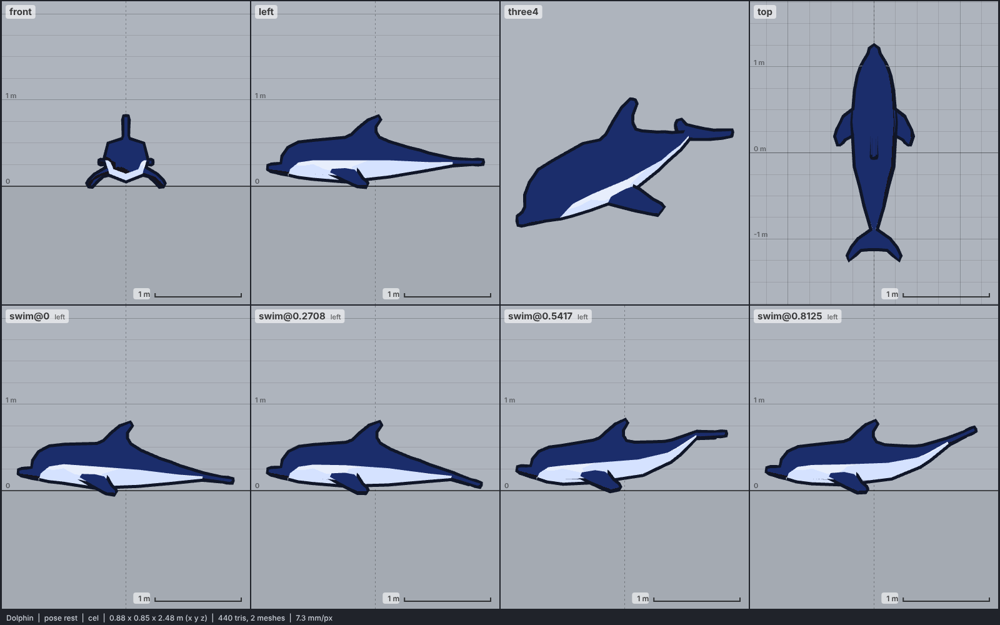 | `dolphin` | Dolphin *low-poly, flat colours (Quaternius 2018)* | 0.8 m | 440 | swim | CC0 1.0 | [Quaternius · Animated Fish](https://opengameart.org/content/animated-fish) |
| 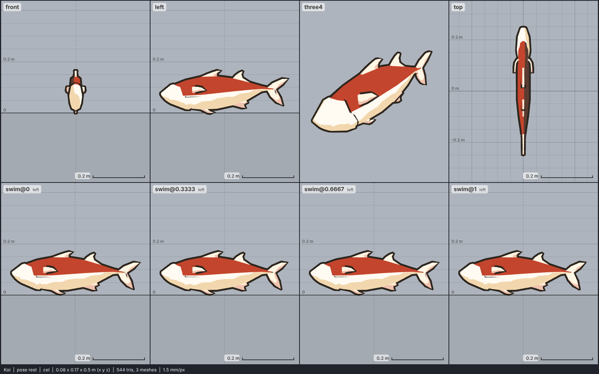 | `koi` | Koi *low-poly, flat colours (Quaternius 2018)* | 0.165 m | 544 | swim | CC0 1.0 | [Quaternius · Animated Fish](https://opengameart.org/content/animated-fish) |
| 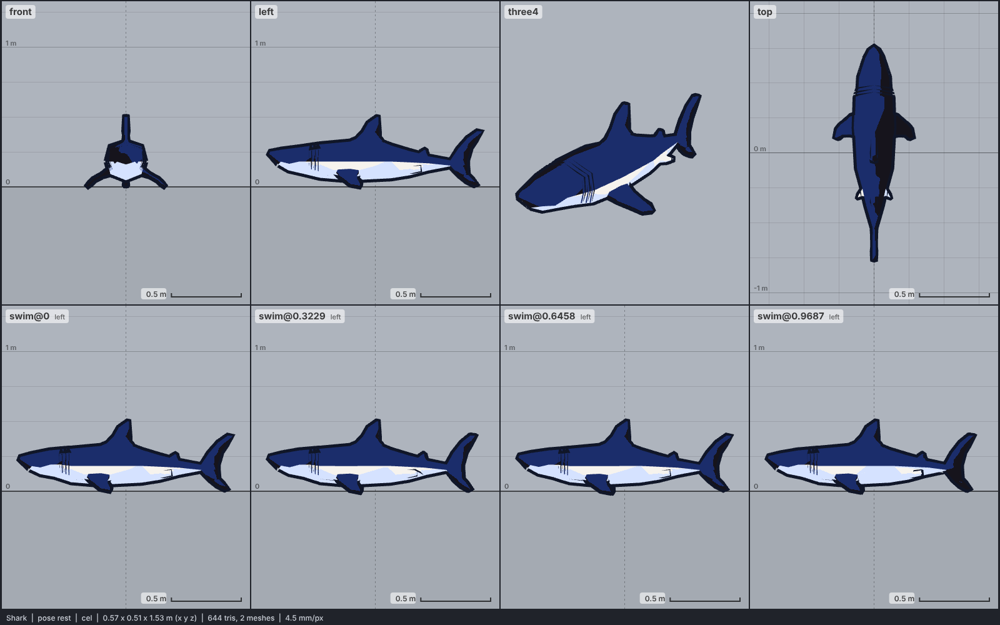 | `shark` | Shark *low-poly, flat colours (Quaternius 2018)* | 0.5 m | 644 | swim | CC0 1.0 | [Quaternius · Animated Fish](https://opengameart.org/content/animated-fish) |
| 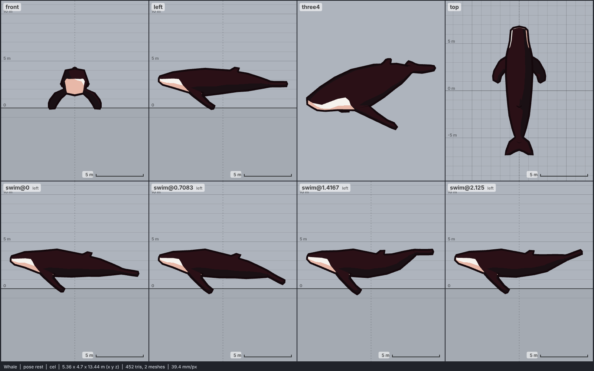 | `whale` | Whale *low-poly, flat colours (Quaternius 2018)* | 4.2 m | 452 | swim | CC0 1.0 | [Quaternius · Animated Fish](https://opengameart.org/content/animated-fish) |

## food

| preview | id | model | height | tris | clips | licence | source |
| --- | --- | --- | --- | --- | --- | --- | --- |
| 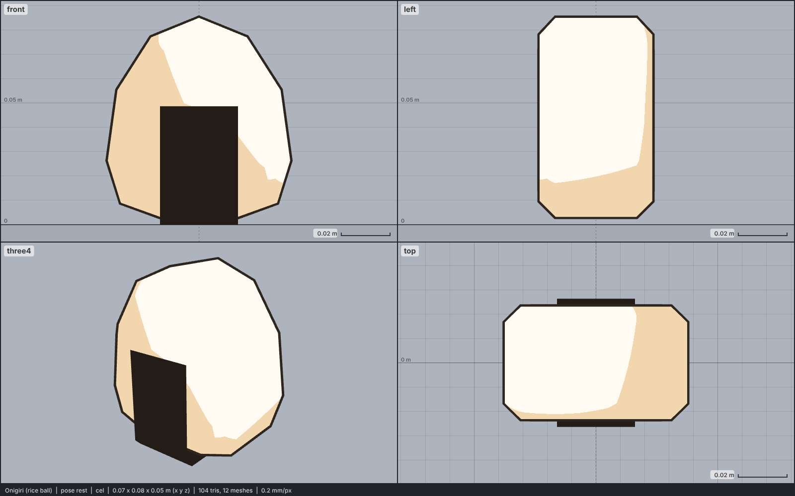 | `onigiri` | Onigiri (rice ball) *low-poly, colour-map texture flattened to flat colours; Kenney's rice ball is taller than wide, so at 0.085 m tall it is 0.075 m wide and 0.053 m thick* | 0.085 m | 104 | - | CC0 1.0 | [Kenney · Food Kit](https://kenney.nl/assets/food-kit) |
| 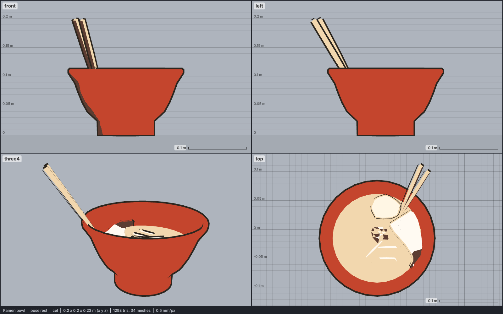 | `ramen` | Ramen bowl *low-poly, photo-projected texture flattened to flat colours; height 0.2 m is the chopstick tips, the bowl itself is ~0.115 m tall and ~0.20 m across* | 0.2 m | 1298 | - | CC0 1.0 | [DREAM_SEARCH_REPEAT · Ramen](https://opengameart.org/content/ramen) |
| 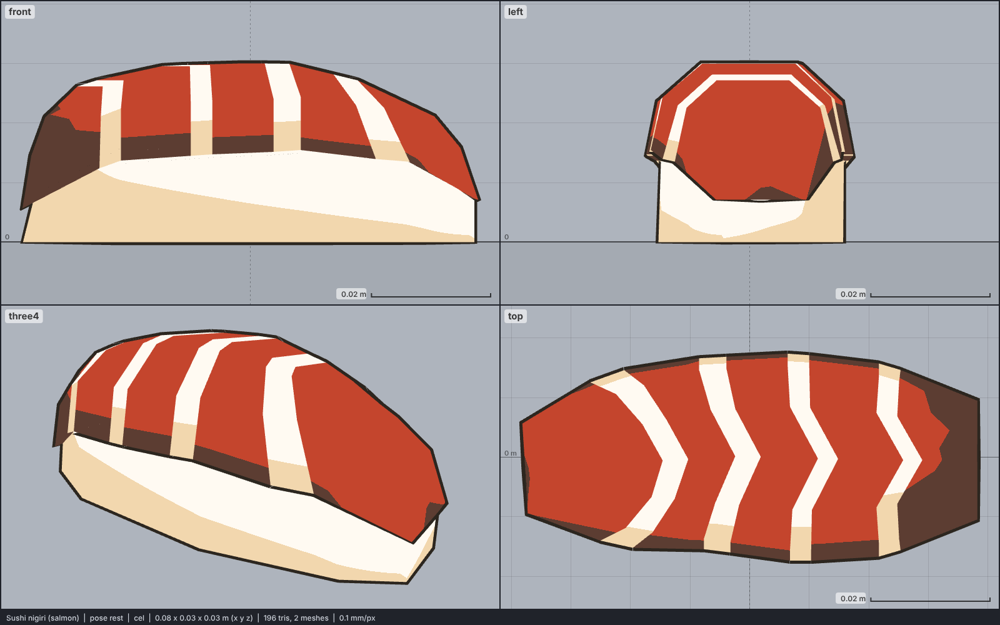 | `sushi-nigiri` | Sushi nigiri (salmon) *low-poly, flat colours; a salmon slice draped over a rounded rice block, white fat lines in a chevron; 0.03 m tall makes it 0.076 m long and 0.035 m wide, a real nigiri* | 0.03 m | 196 | - | CC0 1.0 | [Quaternius · Ultimate Food Pack](https://opengameart.org/content/low-poly-food-pack) |
| 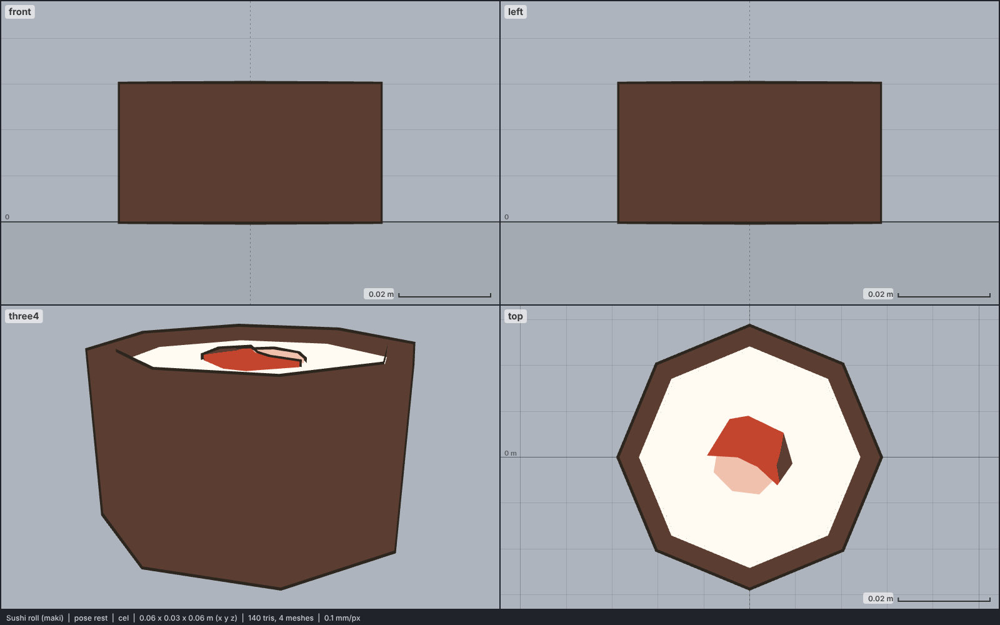 | `sushi-roll` | Sushi roll (maki) *low-poly, flat colours; an octagonal slice cut-face up: nori band, rice ring, salmon and cucumber filling. The pack models it squat (1.9 : 1), so at a real 0.03 m tall it is 0.057 m across, a futomaki-sized slice rather than a thin hosomaki* | 0.03 m | 140 | - | CC0 1.0 | [Quaternius · Ultimate Food Pack](https://opengameart.org/content/low-poly-food-pack) |

## insect

| preview | id | model | height | tris | clips | licence | source |
| --- | --- | --- | --- | --- | --- | --- | --- |
| 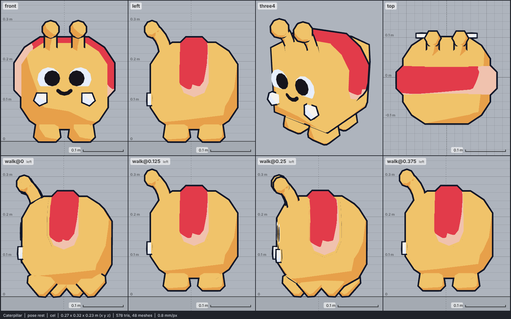 | `caterpillar` | Caterpillar *chibi cube pet, deliberately blocky (Kenney Cube Pets): one round, cube-like segment with four stubby feet, two knobbed antennae, white mandibles and a raised band across the back; coloured as a yellow caterpillar with a red back band (the cel scripts have no green); stylized size: 0.3 m to the top of the antennae, half the cube-pet monkey (0.6 m) and about knee-high on it, so in a garden two-shot the face and antennae still read while it stays clearly the small creature (a real caterpillar is about 5 cm, which would be a speck beside the monkey); rigid parts moved by node tracks, no skin; colour map flattened to flat colours* | 0.3 m | 578 | idle, walk, run, dance, eat | CC0 1.0 | [Kenney · Cube Pets](https://kenney.nl/assets/cube-pets) |

## mammal

| preview | id | model | height | tris | clips | licence | source |
| --- | --- | --- | --- | --- | --- | --- | --- |
| 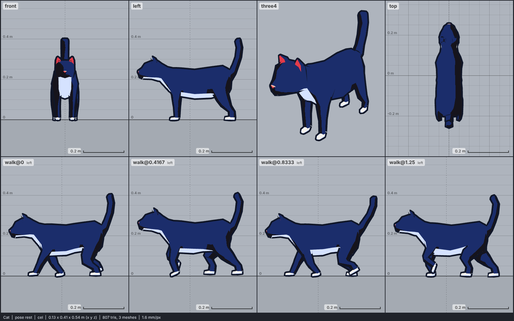 | `cat` | Cat *low-poly, flat colours (Quaternius 2017)* | 0.4 m | 807 | idle, walk | CC0 1.0 | [Quaternius · Animal Pack Vol.2](https://opengameart.org/content/animated-animales-low-poly) |
| 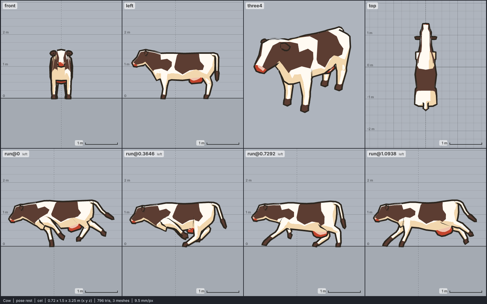 | `cow` | Cow *low-poly, flat colours (Quaternius 2018)* | 1.5 m | 796 | idle, walk, run, jump, death | CC0 1.0 | [Quaternius · LowPoly Animated Farm Animal Pack](https://opengameart.org/content/lowpoly-animated-farm-animal-pack) |
| 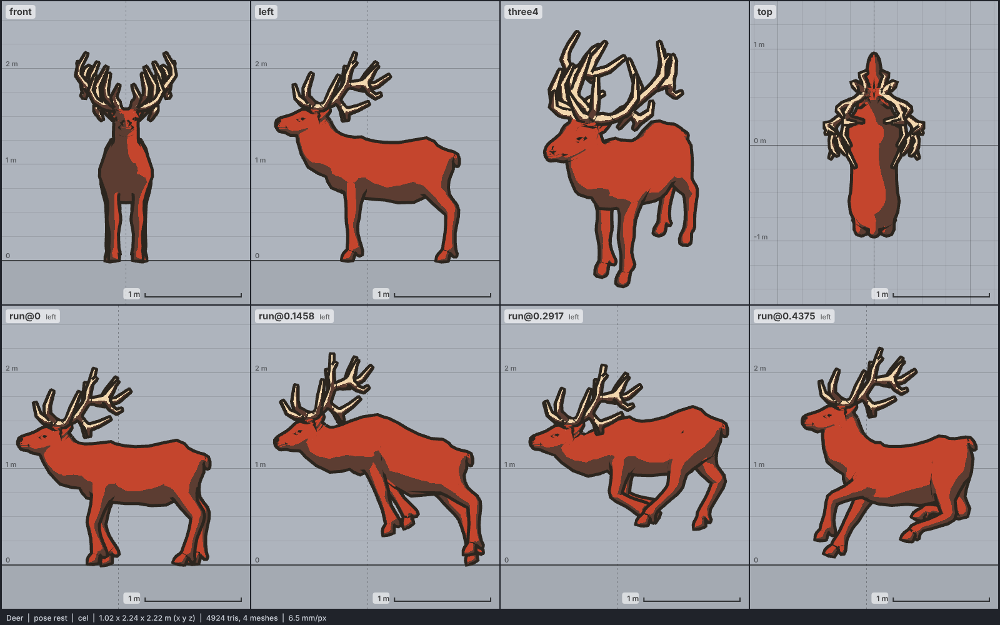 | `deer` | Deer *mid-poly, realistic proportions (CDmir 2015); textures dropped, flat material colours* | 2.15 m | 4924 | idle, eat, run, death | CC0 1.0 | [CDmir · Old Deer Male (Kelgar)](https://opengameart.org/content/old-deer-male) |
| 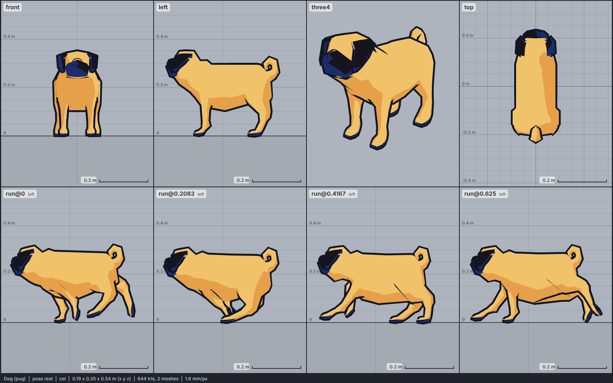 | `dog` | Dog (pug) *low-poly, flat colours (Quaternius 2018)* | 0.35 m | 644 | idle, walk, run, jump, death | CC0 1.0 | [Quaternius · LowPoly Animated Farm Animal Pack](https://opengameart.org/content/lowpoly-animated-farm-animal-pack) |
| 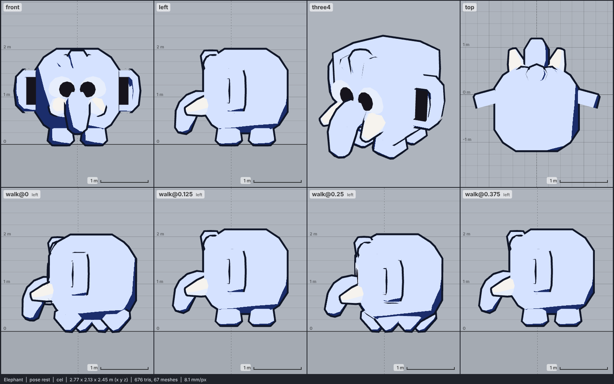 | `elephant` | Elephant *chibi cube pet, deliberately blocky (Kenney Cube Pets); stylized size: 2.0 m tall (a real elephant is ~3 m at the shoulder), so it stands above the library's horse (1.7 m) and cow (1.5 m) without a cube 3 m tall dwarfing every scene; rigid parts moved by node tracks, no skin; colour map flattened to flat colours* | 2 m | 676 | idle, walk, run, dance, eat | CC0 1.0 | [Kenney · Cube Pets](https://kenney.nl/assets/cube-pets) |
|  | `fox` | Fox *low-poly, flat colours (from a painted texture)* | 0.48 m | 576 | idle, walk, run | CC BY 4.0 | [Khronos glTF Sample Assets · Fox](https://github.com/KhronosGroup/glTF-Sample-Assets/tree/main/Models/Fox) |
|  | `giraffe` | Giraffe *chibi cube pet, deliberately blocky (Kenney Cube Pets): the pack's giraffe is a neckless head-body cube with ossicones, so its size is the cube's; stylized size: 2.4 m to the ossicone tips (a real giraffe is ~5 m tall), so it is the tallest animal in the library like the real one, standing just above the cube-pet elephant (2.0 m) and well above the horse (1.7 m) and lion (1.3 m); scaling it to its real height would make a 4.5 m-wide cube that dwarfs the elephant, and the cube itself (2.0 m to the crown) matches the elephant's; rigid parts moved by node tracks, no skin; colour map flattened to flat colours (maxColors 32 keeps the spots, eyes and nose apart; at 16 the eye whites and pupils merged into the coat)* | 2.4 m | 598 | idle, walk, run, dance, eat | CC0 1.0 | [Kenney · Cube Pets](https://kenney.nl/assets/cube-pets) |
|  | `horse` | Horse *low-poly, flat colours (Quaternius 2018)* | 1.7 m | 690 | idle, walk, run, jump, death | CC0 1.0 | [Quaternius · LowPoly Animated Farm Animal Pack](https://opengameart.org/content/lowpoly-animated-farm-animal-pack) |
|  | `lion` | Lion *chibi cube pet, deliberately blocky (Kenney Cube Pets); stylized size: 1.3 m to the top of the mane (a real lion is ~1.2 m at the shoulder), so it stands below the library's horse (1.7 m) and the cube-pet elephant (2.0 m) in the same ratio as the real animals' shoulder heights, without a mane-heavy cube dwarfing them; rigid parts moved by node tracks, no skin; colour map flattened to flat colours* | 1.3 m | 889 | idle, walk, run, dance, eat | CC0 1.0 | [Kenney · Cube Pets](https://kenney.nl/assets/cube-pets) |
|  | `monkey` | Monkey *chibi cube pet, deliberately blocky (Kenney Cube Pets), coloured as a Japanese macaque (snow monkey): pale grey-white fur, red face and ear insides; stylized size: 0.6 m to the top of the head, about a real macaque's height sitting up or standing with its head raised (0.45-0.55 m at the shoulder on all fours), so it sits under the cube-pet panda (0.9 m) and lion (1.3 m) in roughly the real animals' ratio and reaches a 1.7 m adult's knee; rigid parts moved by node tracks, no skin; colour map flattened to flat colours* | 0.6 m | 918 | idle, walk, run, dance, eat | CC0 1.0 | [Kenney · Cube Pets](https://kenney.nl/assets/cube-pets) |
|  | `panda` | Panda *chibi cube pet, deliberately blocky (Kenney Cube Pets); stylized size: 0.9 m tall, about a real giant panda's height on all fours (0.6-0.8 m at the shoulder, the head a little higher), so it sits under the library's cow (1.5 m) and beside a 1.7 m adult's hip; rigid parts moved by node tracks, no skin; colour map flattened to flat colours* | 0.9 m | 734 | idle, walk, run, dance, eat | CC0 1.0 | [Kenney · Cube Pets](https://kenney.nl/assets/cube-pets) |
|  | `pig` | Pig *low-poly, flat colours (Quaternius 2018)* | 0.85 m | 562 | idle, walk, run, jump, death | CC0 1.0 | [Quaternius · LowPoly Animated Farm Animal Pack](https://opengameart.org/content/lowpoly-animated-farm-animal-pack) |
|  | `wolf` | Wolf *low-poly, hand-painted texture flattened to flat colours (CoinCoin 2021)* | 0.85 m | 1334 | idle, run, attack, hit, death, turn, howl | CC BY 4.0 | [CoinCoin · Animated Wolf](https://opengameart.org/content/animated-wolf) |

## monster

| preview | id | model | height | tris | clips | licence | source |
| --- | --- | --- | --- | --- | --- | --- | --- |
|  | `dragon-cute` | Dragon (cute) *low-poly chibi monster (Quaternius 2020), hand-painted texture flattened to flat colours; 0.8 m is a pet-sized pick for a stylized creature with no real-world size (wingspan 1.56 m)* | 0.8 m | 1592 | idle, fly, attack, hit, death | CC0 1.0 | [Quaternius · Textured Cute Monster Pack (Aug 2020)](https://opengameart.org/content/textured-cute-monster-pack) |

## nature

| preview | id | model | height | tris | clips | licence | source |
| --- | --- | --- | --- | --- | --- | --- | --- |
|  | `bush` | Bush *low-poly, flat colours, stacked faceted leaf mounds (Quaternius 2019)* | 1 m | 268 | - | CC0 1.0 | [Quaternius · Ultimate Nature Pack (Jun 2019)](https://opengameart.org/content/low-poly-nature-pack-1) |
|  | `flowers` | Flower group *low-poly, flat colours, three cup-shaped blooms on thin stems (Quaternius 2019)* | 0.4 m | 408 | - | CC0 1.0 | [Quaternius · Ultimate Nature Pack (Jun 2019)](https://opengameart.org/content/low-poly-nature-pack-1) |
|  | `grass` | Grass *low-poly, flat colours, pointed blade cards (Quaternius 2019)* | 0.25 m | 192 | - | CC0 1.0 | [Quaternius · Ultimate Nature Pack (Jun 2019)](https://opengameart.org/content/low-poly-nature-pack-1) |
|  | `rock-large` | Large rock *low-poly, flat colours, faceted boulder (Quaternius 2019)* | 1.2 m | 72 | - | CC0 1.0 | [Quaternius · Ultimate Nature Pack (Jun 2019)](https://opengameart.org/content/low-poly-nature-pack-1) |
|  | `tree` | Tree *low-poly, flat colours, rounded faceted canopy (Quaternius 2019)* | 7 m | 2952 | - | CC0 1.0 | [Quaternius · Ultimate Nature Pack (Jun 2019)](https://opengameart.org/content/low-poly-nature-pack-1) |
|  | `tree-autumn` | Autumn tree *low-poly, flat colours, clustered faceted crown on a forked white birch trunk (Quaternius 2019)* | 9 m | 2338 | - | CC0 1.0 | [Quaternius · Ultimate Nature Pack (Jun 2019)](https://opengameart.org/content/low-poly-nature-pack-1) |
|  | `tree-pine` | Pine tree *low-poly, flat colours, tiered faceted canopy (Quaternius 2019)* | 10 m | 1704 | - | CC0 1.0 | [Quaternius · Ultimate Nature Pack (Jun 2019)](https://opengameart.org/content/low-poly-nature-pack-1) |

## people

| preview | id | model | height | tris | clips | licence | source |
| --- | --- | --- | --- | --- | --- | --- | --- |
|  | `mini-female-a` | Mini character female A *chibi low-poly, flat colour map (Kenney 2024)* | 1.1 m | 876 | idle, walk, run, jump, sit, death, attack, attack-kick-left, attack-kick-right, attack-melee-left, crouch, drive, emote-no, emote-yes, fall, holding-both, holding-both-shoot, holding-left, holding-left-shoot, holding-right, holding-right-shoot, interact-left, interact-right, pick-up, static, wheelchair-look-left, wheelchair-look-right, wheelchair-move-back, wheelchair-move-forward, wheelchair-move-left, wheelchair-move-right, wheelchair-sit | CC0 1.0 | [Kenney · Mini Characters](https://kenney.nl/assets/mini-characters) |
|  | `mini-female-b` | Mini character female B *chibi low-poly, flat colour map (Kenney 2024)* | 1.1 m | 742 | idle, walk, run, jump, sit, death, attack, attack-kick-left, attack-kick-right, attack-melee-left, crouch, drive, emote-no, emote-yes, fall, holding-both, holding-both-shoot, holding-left, holding-left-shoot, holding-right, holding-right-shoot, interact-left, interact-right, pick-up, static, wheelchair-look-left, wheelchair-look-right, wheelchair-move-back, wheelchair-move-forward, wheelchair-move-left, wheelchair-move-right, wheelchair-sit | CC0 1.0 | [Kenney · Mini Characters](https://kenney.nl/assets/mini-characters) |
|  | `mini-female-c` | Mini character female C *chibi low-poly, flat colour map (Kenney 2024)* | 1.1 m | 732 | idle, walk, run, jump, sit, death, attack, attack-kick-left, attack-kick-right, attack-melee-left, crouch, drive, emote-no, emote-yes, fall, holding-both, holding-both-shoot, holding-left, holding-left-shoot, holding-right, holding-right-shoot, interact-left, interact-right, pick-up, static, wheelchair-look-left, wheelchair-look-right, wheelchair-move-back, wheelchair-move-forward, wheelchair-move-left, wheelchair-move-right, wheelchair-sit | CC0 1.0 | [Kenney · Mini Characters](https://kenney.nl/assets/mini-characters) |
|  | `mini-male-a` | Mini character male A *chibi low-poly, flat colour map (Kenney 2024)* | 1.1 m | 723 | idle, walk, run, jump, sit, death, attack, attack-kick-left, attack-kick-right, attack-melee-left, crouch, drive, emote-no, emote-yes, fall, holding-both, holding-both-shoot, holding-left, holding-left-shoot, holding-right, holding-right-shoot, interact-left, interact-right, pick-up, static, wheelchair-look-left, wheelchair-look-right, wheelchair-move-back, wheelchair-move-forward, wheelchair-move-left, wheelchair-move-right, wheelchair-sit | CC0 1.0 | [Kenney · Mini Characters](https://kenney.nl/assets/mini-characters) |
|  | `mini-male-b` | Mini character male B *chibi low-poly, flat colour map (Kenney 2024)* | 1.1 m | 690 | idle, walk, run, jump, sit, death, attack, attack-kick-left, attack-kick-right, attack-melee-left, crouch, drive, emote-no, emote-yes, fall, holding-both, holding-both-shoot, holding-left, holding-left-shoot, holding-right, holding-right-shoot, interact-left, interact-right, pick-up, static, wheelchair-look-left, wheelchair-look-right, wheelchair-move-back, wheelchair-move-forward, wheelchair-move-left, wheelchair-move-right, wheelchair-sit | CC0 1.0 | [Kenney · Mini Characters](https://kenney.nl/assets/mini-characters) |
|  | `mini-male-c` | Mini character male C *chibi low-poly, flat colour map (Kenney 2024)* | 1.1 m | 793 | idle, walk, run, jump, sit, death, attack, attack-kick-left, attack-kick-right, attack-melee-left, crouch, drive, emote-no, emote-yes, fall, holding-both, holding-both-shoot, holding-left, holding-left-shoot, holding-right, holding-right-shoot, interact-left, interact-right, pick-up, static, wheelchair-look-left, wheelchair-look-right, wheelchair-move-back, wheelchair-move-forward, wheelchair-move-left, wheelchair-move-right, wheelchair-sit | CC0 1.0 | [Kenney · Mini Characters](https://kenney.nl/assets/mini-characters) |

## prop

| preview | id | model | height | tris | clips | licence | source |
| --- | --- | --- | --- | --- | --- | --- | --- |
|  | `chair-desk` | Classroom chair *low-poly, flat colours (Kenney Furniture Kit 2.0)* | 0.85 m | 92 | - | CC0 1.0 | [Kenney · Furniture Kit](https://kenney.nl/assets/furniture-kit) |
|  | `desk-teacher` | Teacher's desk *low-poly, flat colours (Kenney Furniture Kit 2.0)* | 0.74 m | 198 | - | CC0 1.0 | [Kenney · Furniture Kit](https://kenney.nl/assets/furniture-kit) |
|  | `katana` | Katana *photoscan-detail mesh (Poly Haven); texture flattened to a few flat colours* | 1 m | 6670 | - | CC0 1.0 | [Poly Haven · Antique Katana 01](https://polyhaven.com/a/antique_katana_01) |
|  | `lantern` | Lantern (stone post, tōrō stand-in) *low-poly, colour map flattened to flat colours* | 2 m | 172 | - | CC0 1.0 | [Kenney · Holiday Kit](https://kenney.nl/assets/holiday-kit) |
|  | `sofa` | Sofa *low-poly, flat colours (Kenney Furniture Kit 2.0)* | 0.89 m | 128 | - | CC0 1.0 | [Kenney · Furniture Kit](https://kenney.nl/assets/furniture-kit) |
|  | `street-light` | Street light *low-poly, flat colours (Kenney City Kit Roads)* | 7 m | 92 | - | CC0 1.0 | [Kenney · City Kit Roads](https://kenney.nl/assets/city-kit-roads) |
|  | `sword` | Sword (one-handed) *low-poly, hard-surface, flat colours (Quaternius 2018)* | 0.9 m | 872 | - | CC0 1.0 | [Quaternius · Medieval Weapons Pack (Sept 2018)](https://opengameart.org/content/lowpoly-medieval-weapons) |
|  | `traffic-light` | Traffic light *low-poly, flat colours (Kenney City Kit Roads)* | 5 m | 230 | - | CC0 1.0 | [Kenney · City Kit Roads](https://kenney.nl/assets/city-kit-roads) |
|  | `vending-machine` | Drinks vending machine *voxel (MagicaVoxel), palette texture flattened to flat colours* | 1.83 m | 2340 | - | CC0 1.0 | [MonoTone · Voxel Vending Machine](https://opengameart.org/content/voxel-vending-machine) |

## sea life

| preview | id | model | height | tris | clips | licence | source |
| --- | --- | --- | --- | --- | --- | --- | --- |
|  | `crab` | Crab *chibi cube pet, deliberately blocky (Kenney Cube Pets); stylized size: 0.18 m tall, which makes the claw-tip span about 0.3 m, the width of a large edible crab (a 15-20 cm shell plus raised claws), so it sits at a 1.7 m adult's ankle; the cube body is far taller than a real crab's flat shell, so the height follows the width, not the other way round; rigid parts moved by node tracks, no skin; colour map flattened to flat colours* | 0.18 m | 676 | idle, walk, run, dance, eat | CC0 1.0 | [Kenney · Cube Pets](https://kenney.nl/assets/cube-pets) |

## vehicle

| preview | id | model | height | tris | clips | licence | source |
| --- | --- | --- | --- | --- | --- | --- | --- |
|  | `car-delivery` | Delivery truck *low-poly, flat colours (Kenney Car Kit)* | 2.8 m | 2476 | - | CC0 1.0 | [Kenney · Car Kit](https://kenney.nl/assets/car-kit) |
|  | `car-hatchback` | Hatchback sports *low-poly, flat colours (Kenney Car Kit)* | 1.4 m | 2088 | - | CC0 1.0 | [Kenney · Car Kit](https://kenney.nl/assets/car-kit) |
|  | `car-police` | Police car *low-poly, flat colours (Kenney Car Kit)* | 1.6 m | 2304 | - | CC0 1.0 | [Kenney · Car Kit](https://kenney.nl/assets/car-kit) |
|  | `car-sedan` | Sedan *low-poly, flat colours (Kenney Car Kit)* | 1.45 m | 2032 | - | CC0 1.0 | [Kenney · Car Kit](https://kenney.nl/assets/car-kit) |
|  | `car-sports-sedan` | Sports sedan *low-poly, flat colours (Kenney Car Kit)* | 1.34 m | 2087 | - | CC0 1.0 | [Kenney · Car Kit](https://kenney.nl/assets/car-kit) |
|  | `car-suv` | SUV *low-poly, flat colours (Kenney Car Kit)* | 1.7 m | 2474 | - | CC0 1.0 | [Kenney · Car Kit](https://kenney.nl/assets/car-kit) |
|  | `car-taxi` | Taxi *low-poly, flat colours (Kenney Car Kit)* | 1.55 m | 2072 | - | CC0 1.0 | [Kenney · Car Kit](https://kenney.nl/assets/car-kit) |
|  | `car-van` | Van *low-poly, flat colours (Kenney Car Kit)* | 2.3 m | 2082 | - | CC0 1.0 | [Kenney · Car Kit](https://kenney.nl/assets/car-kit) |
|  | `train-bullet` | Bullet train (shinkansen) *low-poly, flat colours (Kenney Train Kit)* | 3.7 m | 1261 | - | CC0 1.0 | [Kenney · Train Kit](https://kenney.nl/assets/train-kit) |
|  | `train-commuter` | City commuter train *low-poly, flat colours (Kenney Train Kit)* | 3.8 m | 1130 | - | CC0 1.0 | [Kenney · Train Kit](https://kenney.nl/assets/train-kit) |
|  | `train-tram` | Modern tram (low-floor streetcar) *low-poly, flat colours (Kenney Train Kit)* | 5.2 m | 1498 | - | CC0 1.0 | [Kenney · Train Kit](https://kenney.nl/assets/train-kit) |

## vehicle-space

| preview | id | model | height | tris | clips | licence | source |
| --- | --- | --- | --- | --- | --- | --- | --- |
|  | `spaceship` | Spaceship (fighter) *low-poly, hard-surface, painted texture flattened (Quaternius Ultimate Spaceships 2021)* | 3.8 m | 4530 | - | CC0 1.0 | [Quaternius · Ultimate Spaceships (May 2021)](https://opengameart.org/content/lowpoly-spaceships-pack) |

## vehicle-water

| preview | id | model | height | tris | clips | licence | source |
| --- | --- | --- | --- | --- | --- | --- | --- |
|  | `boat-fishing` | Fishing boat *low-poly, flat colours (Kenney Watercraft Kit)* | 4.2 m | 237 | - | CC0 1.0 | [Kenney · Watercraft Kit](https://kenney.nl/assets/watercraft-kit) |
|  | `boat-sail` | Sailboat *low-poly, flat colours (Kenney Watercraft Kit)* | 8 m | 386 | - | CC0 1.0 | [Kenney · Watercraft Kit](https://kenney.nl/assets/watercraft-kit) |
|  | `ship-pirate` | Pirate ship *low-poly, flat colours (Kenney Pirate Kit)* | 20 m | 1812 | - | CC0 1.0 | [Kenney · Pirate Kit](https://kenney.nl/assets/pirate-kit) |
