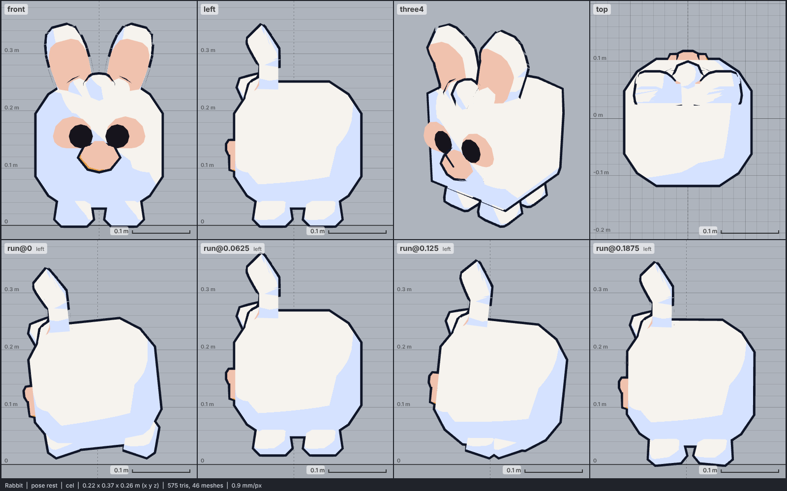

# Model library catalog

> Generated by `npm run library:catalog` from `models/library/*/meta.json`. Do not edit by hand.
> How to use a library model: `harness/library/README.md`. Code models (`models/*.js`) are listed in `skills/html-anime-model/SKILL.md`.

1 model, 0.1 MB of GLB.

## mammal

| preview | id | model | height | tris | clips | licence | source |
| --- | --- | --- | --- | --- | --- | --- | --- |
|  | `rabbit` | Rabbit *chibi cube pet, deliberately blocky (Kenney Cube Pets); height 0.35 m to the ear tips, a real rabbit's size sitting up (0.25-0.4 m), so it sits under the library's cat (0.4 m tail tip) and at a 1.7 m adult's shin; rigid parts moved by node tracks, no skin; colour map flattened to flat colours* | 0.35 m | 575 | idle, walk, run, eat, dance | CC0 1.0 | [Kenney · Cube Pets](https://kenney.nl/assets/cube-pets) |
