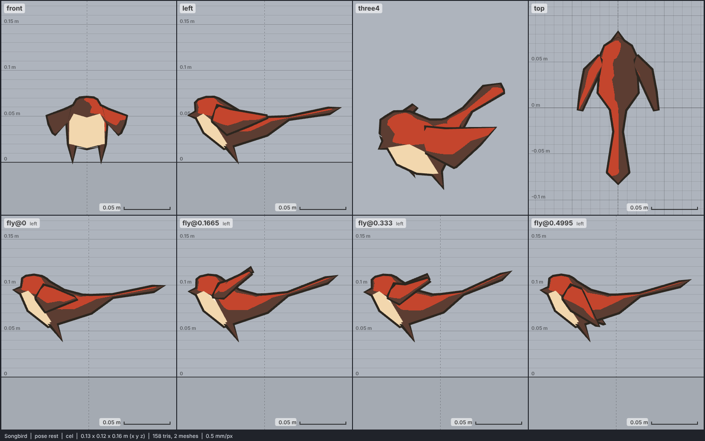

# Model library catalog

> Generated by `npm run library:catalog` from `models/library/*/meta.json`. Do not edit by hand.
> How to use a library model: `harness/library/README.md`. Code models (`models/*.js`) are listed in `skills/html-anime-model/SKILL.md`.

1 model, 0.0 MB of GLB.

## bird

| preview | id | model | height | tris | clips | licence | source |
| --- | --- | --- | --- | --- | --- | --- | --- |
|  | `songbird` | Songbird *very low-poly (158 tris), flat colours, faceted origami-like shapes (Quaternius 2016); 0.07 m tall in its rest pose with the wings half raised, 0.16 m beak to tail tip, a house sparrow's length (14-16 cm); the tail is longer and slimmer than a sparrow's* | 0.07 m | 158 | fly | CC0 1.0 | [Quaternius · Animals Pack (5 Low poly animals)](https://opengameart.org/content/5-low-poly-animals) |
