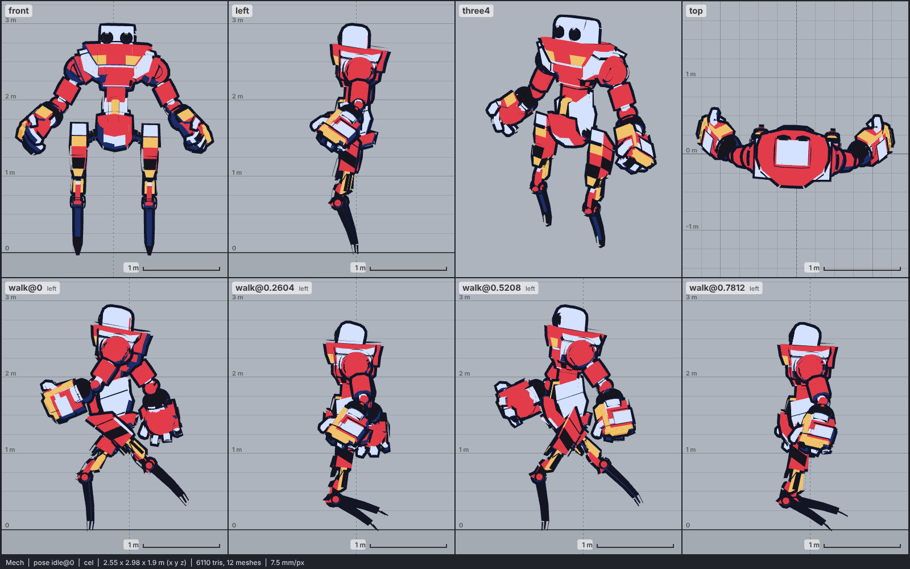

# Model library catalog

> Generated by `npm run library:catalog` from `models/library/*/meta.json`. Do not edit by hand.
> How to use a library model: `harness/library/README.md`. Code models (`models/*.js`) are listed in `skills/html-anime-model/SKILL.md`.

1 model, 0.5 MB of GLB.

## character

| preview | id | model | height | tris | clips | licence | source |
| --- | --- | --- | --- | --- | --- | --- | --- |
|  | `mech` | Mech *low-poly, hard-surface, rusty painted texture flattened to flat colours (Quaternius 2021)* | 3 m | 6110 | idle, walk, run, jump, attack, hit, death, wave, dance | CC0 1.0 | [Quaternius · Animated Mech Pack](https://opengameart.org/content/animated-mech-pack) |
