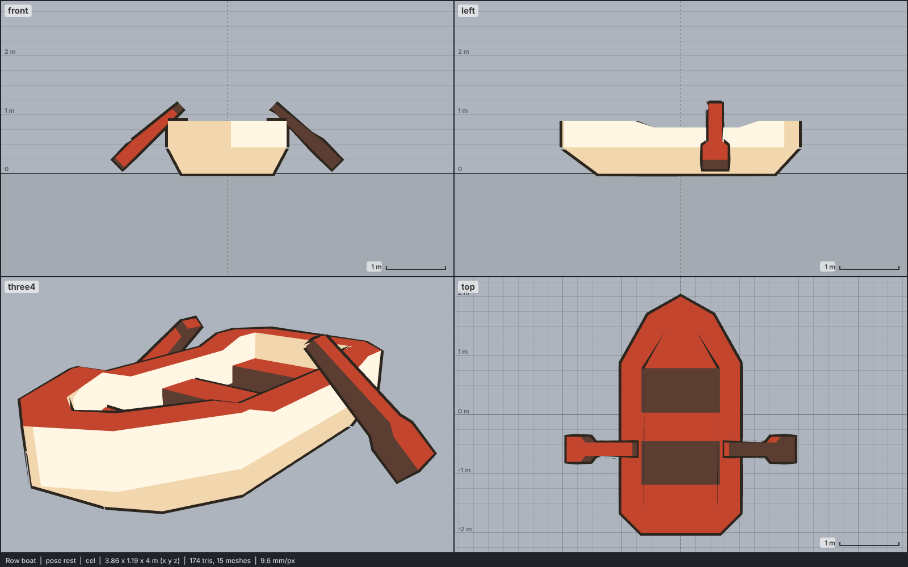

# Model library catalog

> Generated by `npm run library:catalog` from `models/library/*/meta.json`. Do not edit by hand.
> How to use a library model: `harness/library/README.md`. Code models (`models/*.js`) are listed in `skills/html-anime-model/SKILL.md`.

1 model, 0.0 MB of GLB.

## vehicle-water

| preview | id | model | height | tris | clips | licence | source |
| --- | --- | --- | --- | --- | --- | --- | --- |
|  | `boat-row` | Row boat *low-poly, flat colours (Kenney Watercraft Kit)* | 1.19 m | 174 | - | CC0 1.0 | [Kenney · Watercraft Kit](https://kenney.nl/assets/watercraft-kit) |
