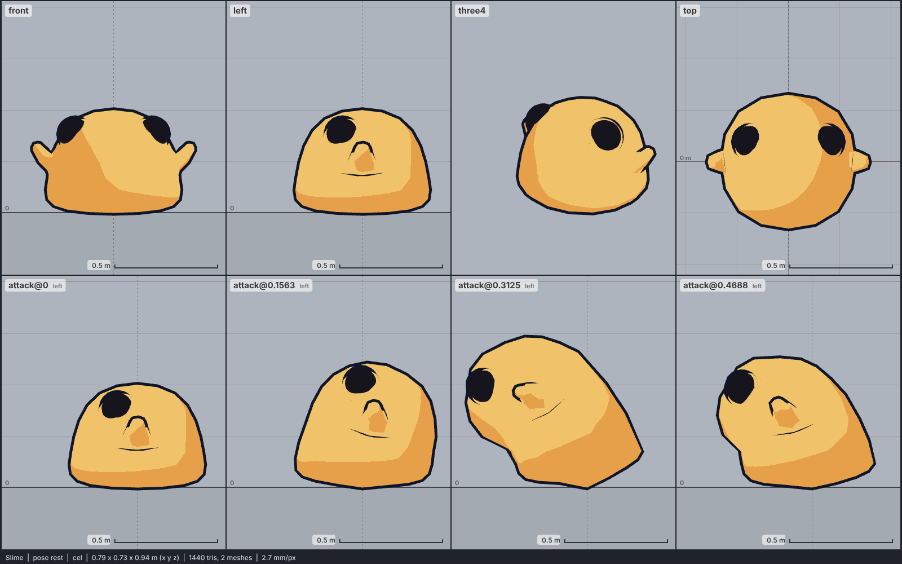

# Model library catalog

> Generated by `npm run library:catalog` from `models/library/*/meta.json`. Do not edit by hand.
> How to use a library model: `harness/library/README.md`. Code models (`models/*.js`) are listed in `skills/html-anime-model/SKILL.md`.

1 model, 0.1 MB of GLB.

## creature

| preview | id | model | height | tris | clips | licence | source |
| --- | --- | --- | --- | --- | --- | --- | --- |
|  | `slime` | Slime *low-poly, flat colours (Quaternius 2018)* | 0.5 m | 1440 | idle, walk, attack, death | CC0 1.0 | [Quaternius · Animated Monster Pack (2018)](https://opengameart.org/content/lowpoly-animated-monsters) |
