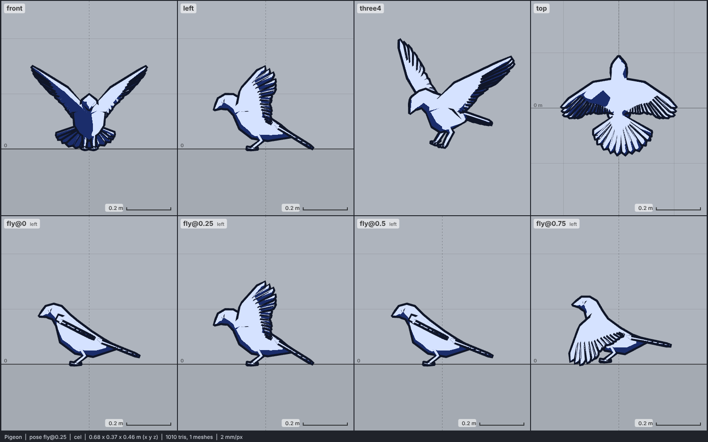

# Model library catalog

> Generated by `npm run library:catalog` from `models/library/*/meta.json`. Do not edit by hand.
> How to use a library model: `harness/library/README.md`. Code models (`models/*.js`) are listed in `skills/html-anime-model/SKILL.md`.

1 model, 0.0 MB of GLB.

## bird

| preview | id | model | height | tris | clips | licence | source |
| --- | --- | --- | --- | --- | --- | --- | --- |
|  | `pigeon` | Pigeon *low-poly flight model (wings always spread, no perched pose); untextured, one material* | 0.27 m | 1010 | idle, fly | CC0 1.0 | [mujtaba-io · Low poly 3D pigeon model (rigged, animated, untextured)](https://opengameart.org/content/low-poly-3d-pigeon-model-rigged-animated-untextured) |
