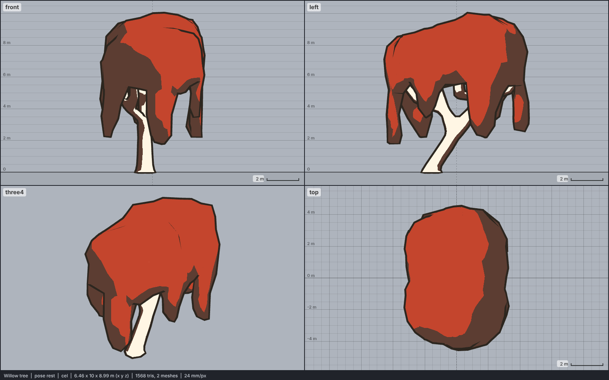

# Model library catalog

> Generated by `npm run library:catalog` from `models/library/*/meta.json`. Do not edit by hand.
> How to use a library model: `harness/library/README.md`. Code models (`models/*.js`) are listed in `skills/html-anime-model/SKILL.md`.

1 model, 0.0 MB of GLB.

## nature

| preview | id | model | height | tris | clips | licence | source |
| --- | --- | --- | --- | --- | --- | --- | --- |
|  | `tree-willow` | Willow tree *low-poly, flat colours, drooping crown of faceted foliage (Quaternius 2019)* | 10 m | 1568 | - | CC0 1.0 | [Quaternius · Ultimate Nature Pack (Jun 2019)](https://opengameart.org/content/low-poly-nature-pack-1) |
