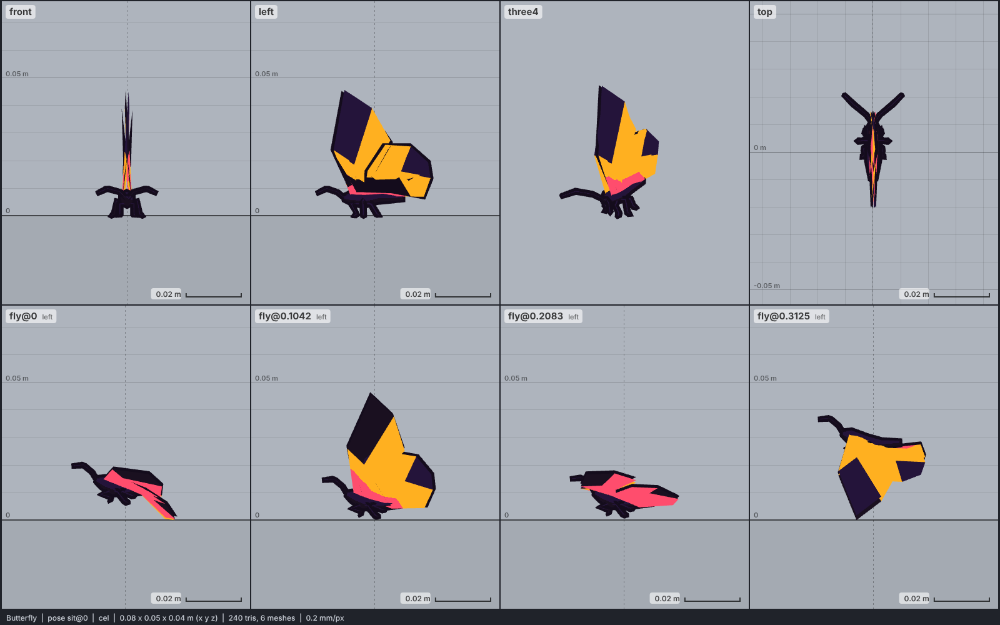

# Model library catalog

> Generated by `npm run library:catalog` from `models/library/*/meta.json`. Do not edit by hand.
> How to use a library model: `harness/library/README.md`. Code models (`models/*.js`) are listed in `skills/html-anime-model/SKILL.md`.

1 model, 0.1 MB of GLB.

## insect

| preview | id | model | height | tris | clips | licence | source |
| --- | --- | --- | --- | --- | --- | --- | --- |
|  | `butterfly` | Butterfly *low-poly card wings (CDmir 2015, 240 tris): a monarch, its photo texture flattened to flat colours: orange wings with dark tips and a dark body; real size: the rest pose lies with wings spread flat, so a 1 cm rest height gives a 7.9 cm wingspan (a monarch is about 9-10 cm, a garden butterfly 6-10 cm)* | 0.01 m | 240 | fly, sit | CC0 1.0 | [CDmir · Butterfly (animated)](https://opengameart.org/content/butterfly-animated) |
