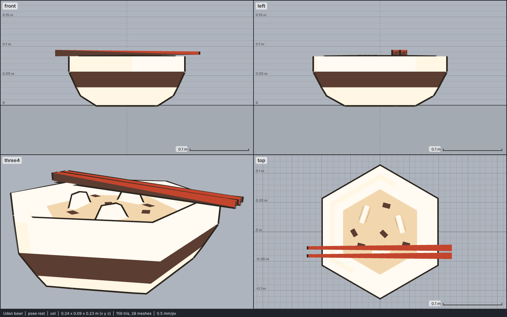

# Model library catalog

> Generated by `npm run library:catalog` from `models/library/*/meta.json`. Do not edit by hand.
> How to use a library model: `harness/library/README.md`. Code models (`models/*.js`) are listed in `skills/html-anime-model/SKILL.md`.

1 model, 0.0 MB of GLB.

## food

| preview | id | model | height | tris | clips | licence | source |
| --- | --- | --- | --- | --- | --- | --- | --- |
|  | `udon` | Udon bowl *low-poly, colour-map texture flattened to flat colours; a hexagonal soup bowl with three thick noodle loops standing out of a pale broth and a pair of kit chopsticks laid across the rim. Normalised to 0.094 m tall (the chopsticks top), which makes the bowl 0.083 m tall and 0.195 m across the flats (0.225 m corner to corner); the chopsticks are 0.245 m long* | 0.094 m | 156 | - | CC0 1.0 | [Kenney · Food Kit](https://kenney.nl/assets/food-kit) |
