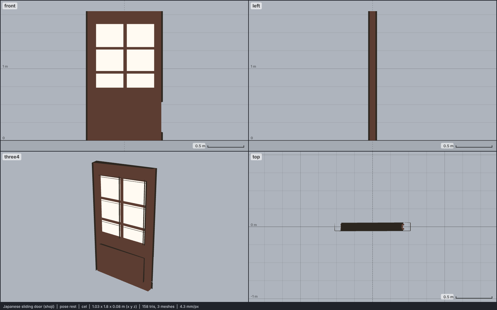

# Model library catalog

> Generated by `npm run library:catalog` from `models/library/*/meta.json`. Do not edit by hand.
> How to use a library model: `harness/library/README.md`. Code models (`models/*.js`) are listed in `skills/html-anime-model/SKILL.md`.

1 model, 0.0 MB of GLB.

## prop

| preview | id | model | height | tris | clips | licence | source |
| --- | --- | --- | --- | --- | --- | --- | --- |
|  | `door-shoji` | Japanese sliding door (shoji) *low-poly game prop (herio 2021); Textures.com photo textures dropped, flat colours* | 1.8 m | 158 | - | CC BY 4.0 | [herio · Japanese school](https://opengameart.org/content/japanese-school) |
