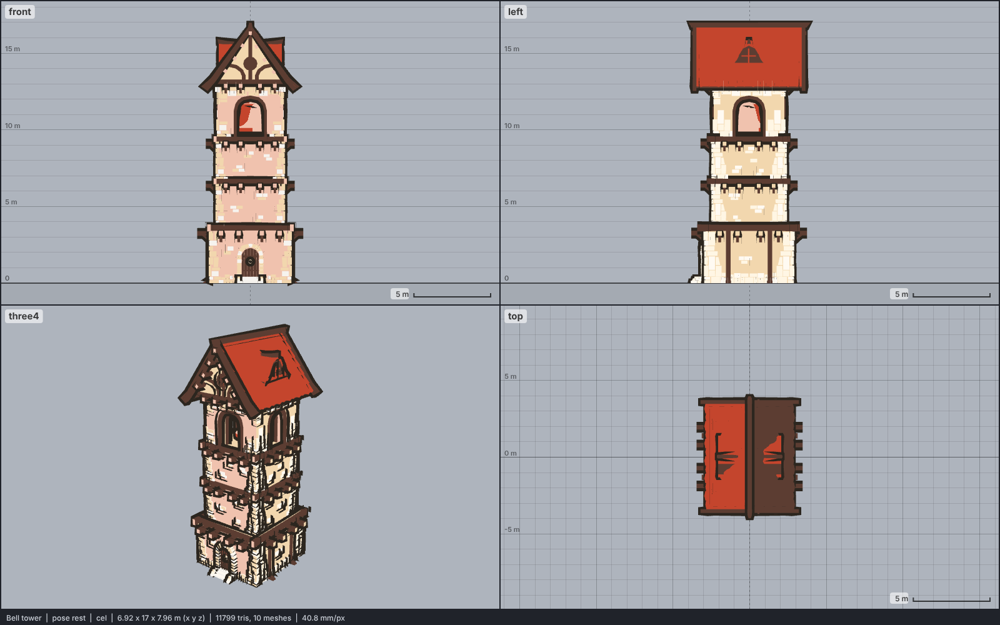

# Model library catalog

> Generated by `npm run library:catalog` from `models/library/*/meta.json`. Do not edit by hand.
> How to use a library model: `harness/library/README.md`. Code models (`models/*.js`) are listed in `skills/html-anime-model/SKILL.md`.

1 model, 0.1 MB of GLB.

## building

| preview | id | model | height | tris | clips | licence | source |
| --- | --- | --- | --- | --- | --- | --- | --- |
|  | `bell-tower` | Bell tower *low-poly, flat colours (Quaternius Medieval Village Pack)* | 17 m | 11799 | - | CC0 1.0 | [Quaternius · Medieval Village Pack](https://opengameart.org/content/lowpoly-medieval-village-pack) |
