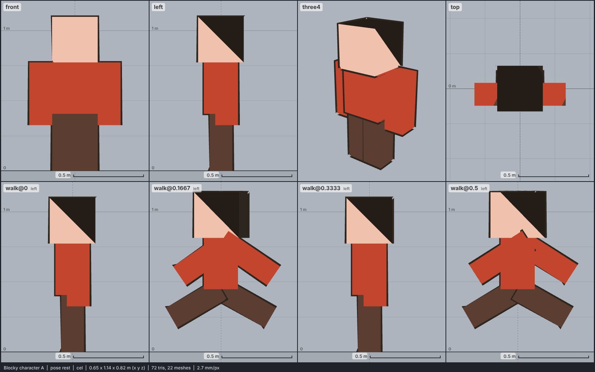

# Model library catalog

> Generated by `npm run library:catalog` from `models/library/*/meta.json`. Do not edit by hand.
> How to use a library model: `harness/library/README.md`. Code models (`models/*.js`) are listed in `skills/html-anime-model/SKILL.md`.

1 model, 0.0 MB of GLB.

## people

| preview | id | model | height | tris | clips | licence | source |
| --- | --- | --- | --- | --- | --- | --- | --- |
|  | `blocky-a` | Blocky character A *blocky low-poly (six cuboids), Minecraft-like skin texture flattened to flat colours (Kenney 2025)* | 1.1 m | 72 | idle, walk, run, sit, death, attack, attack-kick-left, attack-kick-right, attack-melee-left, drive, static, wheelchair-move-back, wheelchair-move-forward, wheelchair-move-left, wheelchair-move-right, wheelchair-sit, emote-no, emote-yes, holding-both-shoot, holding-left-shoot, holding-right-shoot, interact-left, interact-right, pick-up, holding-both, holding-left, holding-right | CC0 1.0 | [Kenney · Blocky Characters](https://kenney.nl/assets/blocky-characters) |
