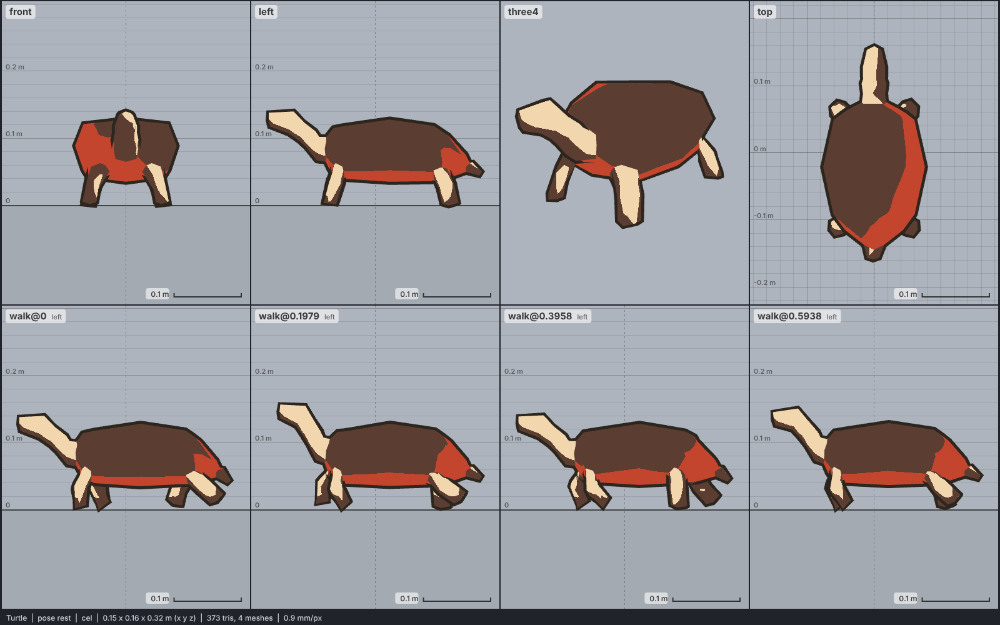

# Model library catalog

> Generated by `npm run library:catalog` from `models/library/*/meta.json`. Do not edit by hand.
> How to use a library model: `harness/library/README.md`. Code models (`models/*.js`) are listed in `skills/html-anime-model/SKILL.md`.

1 model, 0.0 MB of GLB.

## reptile

| preview | id | model | height | tris | clips | licence | source |
| --- | --- | --- | --- | --- | --- | --- | --- |
|  | `turtle` | Turtle *low-poly cartoon (Heathal 2016); painted texture flattened to shell and skin colours* | 0.14 m | 373 | walk | CC0 1.0 | [Heathal · Turtle](https://opengameart.org/content/turtle-0) |
