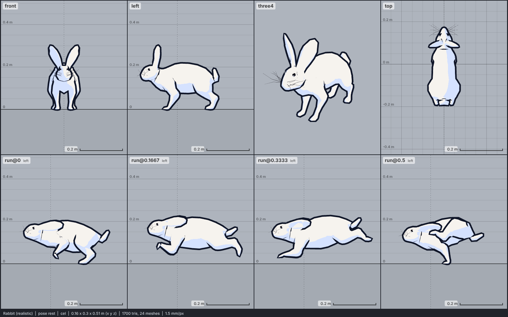

# Model library catalog

> Generated by `npm run library:catalog` from `models/library/*/meta.json`. Do not edit by hand.
> How to use a library model: `harness/library/README.md`. Code models (`models/*.js`) are listed in `skills/html-anime-model/SKILL.md`.

1 model, 0.3 MB of GLB.

## mammal

| preview | id | model | height | tris | clips | licence | source |
| --- | --- | --- | --- | --- | --- | --- | --- |
|  | `rabbit-realistic` | Rabbit (realistic) *mid-poly, realistic proportions (CDmir 2015); photo texture flattened to flat colours; height 0.3 m to the ear tips at rest (crouched on all fours; 0.32 m sitting, 0.4 m standing up in Guarding), a real domestic rabbit's size* | 0.3 m | 1700 | idle, sit, run, jump, death | CC0 1.0 | [CDmir · Rabbit (animated, Kelgar)](https://opengameart.org/content/rabbit-0) |
