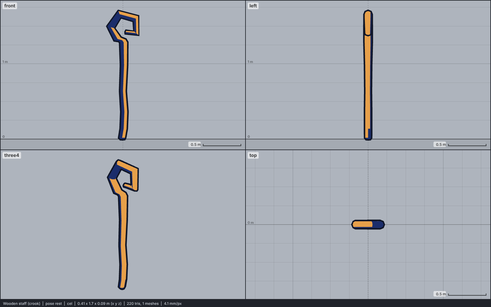

# Model library catalog

> Generated by `npm run library:catalog` from `models/library/*/meta.json`. Do not edit by hand.
> How to use a library model: `harness/library/README.md`. Code models (`models/*.js`) are listed in `skills/html-anime-model/SKILL.md`.

1 model, 0.0 MB of GLB.

## prop

| preview | id | model | height | tris | clips | licence | source |
| --- | --- | --- | --- | --- | --- | --- | --- |
|  | `staff` | Wooden staff (crook) *low-poly, hard-surface, flat colours (Quaternius 2017)* | 1.7 m | 220 | - | CC0 1.0 | [Quaternius · Lowpoly RPG Pack (2017)](https://opengameart.org/content/lowpoly-rpg) |
