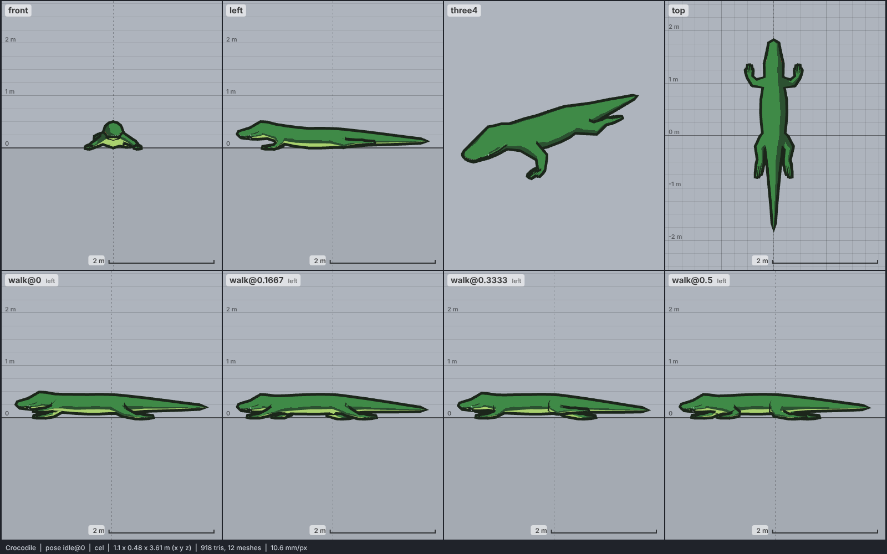

# Model library catalog

> Generated by `npm run library:catalog` from `models/library/*/meta.json`. Do not edit by hand.
> How to use a library model: `harness/library/README.md`. Code models (`models/*.js`) are listed in `skills/html-anime-model/SKILL.md`.

1 model, 0.1 MB of GLB.

## reptile

| preview | id | model | height | tris | clips | licence | source |
| --- | --- | --- | --- | --- | --- | --- | --- |
|  | `crocodile` | Crocodile *low-poly, realistic proportions (br-n518); texture flattened to flat colours. Sized as an adult crocodile 3.6 m long: 0.35 m at the top of the sprawled rest pose, about 0.48 m with the head raised in idle and walk* | 0.35 m | 459 | idle, walk, attack, death | CC0 1.0 | [br-n518 · Crocodile](https://opengameart.org/content/crocodile-0) |
